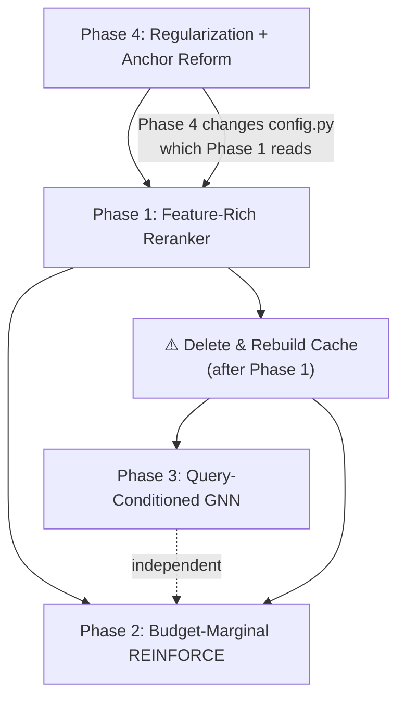

# Implementation Plan v3: Reaching 0.5700 Score

## Goal

Close the gap from the current system (**score = 0.4338, above_floor = +0.3513**) to the **target score of 0.5700** (above_floor ≈ +0.488). The benchmark leader `c_rrf_kind_field_neigh_moves_dedup` achieves **score = 0.589, above_floor = +0.508**.

The current system has exhausted the easy gains from heuristic first-stage improvements (+0.0693 from Phase 1 of the previous plan). The remaining **0.136-point gap** to target is now firmly in neural territory — the RL reranker contributes only +0.0016 over the heuristic baseline, meaning the learned model is essentially inert. This plan targets the root causes.

## Situation Assessment

```
Current Pipeline Performance (10-fold LOO-CV):
  First-Stage (M0+M1):     0.4322  (+0.3496 above floor)  ← strong heuristic stack
  + RL Reranker (M2):       0.4338  (+0.3513)              ← +0.0016 lift (flatlined)
  + GNN Reranker (M3):      0.4181  (+0.3356)              ← -0.0141 DEGRADATION
  Target:                   0.5700  (+0.488)               ← 0.136 gap remaining

Training Dynamics (Master Model, 30 epochs):
  Train reward:  0.3221 → 0.4153  (+29% improvement)
  Greedy eval:   0.4322 → 0.4306  (FLAT → +0.0 improvement)
  → Pure memorization. No generalisation.

Per-Fold RL Delta Over First-Stage (held-out):
  5 folds IMPROVE (+0.0025 to +0.0158)
  5 folds DEGRADE (-0.0007 to -0.0177)
  → Net near-zero. RL is coin-flipping.
```

---

## Diagnosis: 7 Root-Cause Issues

### Issue 1: Blindfolded Neural Reranker (Feature Disconnect) ⭐ CRITICAL

**Evidence**: The reranker's input features are `[q_emb(384), b_emb(384), q⊙b(384), cos(q,b)(1), struct_proj(64)]` = 1217 dims. **Zero lexical features** — no BM25 score, no RRF rank, no token overlap ratio, no first-stage retrieval score.

The first-stage computes 7 rich scoring signals (block BM25, field BM25, dense cosine, RRF fusion, kind multipliers, neighbor expansion, move following) but **discards all of them** before passing candidates to the reranker. The reranker sees only raw MiniLM embeddings and 15 structural features.

**Consequence**: The MLP must re-derive text match strength from raw 384-d embeddings using 313K parameters on 448 training questions (698 params/question). This is why it memorizes instead of generalizing — it lacks the signal the first-stage already computed.

**Quantitative impact**: In [`pipeline.py:108-135`](file:///home/shrawani/Desktop/sem5/Information%20Retrieval%20and%20Extraction/project/MultiAgent-IRBench/method/pipeline.py#L108-L135), `build_training_items` stores `query_emb`, `block_embs`, `struct_feats`, `block_ids` but NONE of `bm25_score`, `rrf_score`, `dense_sim`, or `first_stage_rank`.

---

### Issue 2: Query-Blind GNN ⭐ CRITICAL

**Evidence**: In [`gnn_reranker.py:110-134`](file:///home/shrawani/Desktop/sem5/Information%20Retrieval%20and%20Extraction/project/MultiAgent-IRBench/method/gnn_reranker.py#L110-L134):
```python
def forward(self, block_embs, struct_feats, adj, rl_scores):
    x = torch.cat([block_embs, struct_feats], dim=-1)  # (N, 399)
    # ... GAT layers ...
    gnn_scores = self.score_head(x).squeeze(-1)
    blended = 0.3 * sigmoid(gnn_scores) + 0.7 * sigmoid(rl_scores)
```

`query_emb` is **not an argument**. The GNN computes static, query-independent centrality scores. For any query about any topic, the GNN ranks the same blocks identically — it is literally a query-blind popularity scorer.

**Additional sub-issues**:
- **Bidirectional cliques** ([`gnn_reranker.py:163-173`](file:///home/shrawani/Desktop/sem5/Information%20Retrieval%20and%20Extraction/project/MultiAgent-IRBench/method/gnn_reranker.py#L163-L173)): All edges are symmetrized, and all blocks in the same event form fully-connected cliques. With 2 GAT layers, every node in a connected component converges to the same averaged embedding (over-smoothing).
- **help_desk collapse**: Score dropped from 0.5067 → 0.3633 (−0.1433!) under GNN. The GNN averaged away the discriminative features of high-value blocks.
- **Fixed blend weight**: `GNN_SCORE_BLEND = 0.3` is hardcoded, not query-conditioned. Even when GNN degrades a ranking, it always contributes 30%.
- **No REINFORCE baseline in GNN training** ([`train.py:393`](file:///home/shrawani/Desktop/sem5/Information%20Retrieval%20and%20Extraction/project/MultiAgent-IRBench/method/train.py#L393)): `loss = -(reward * lp)` — raw reward with no baseline subtraction → extreme variance.

---

### Issue 3: Coarse Scalar REINFORCE Credit Assignment ⭐ HIGH

**Evidence**: In [`rl_trainer.py:122-148`](file:///home/shrawani/Desktop/sem5/Information%20Retrieval%20and%20Extraction/project/MultiAgent-IRBench/method/rl_trainer.py#L122-L148):
```python
for _ in range(samples_k):
    perm, lp = plackett_luce_sample(scores, temperature=tau, k=k_trunc)
    result = score_query(answer_entry, ranked_ids, tokens_map)
    rewards_list.append(result["score"])  # ONE scalar for all 50 items
    log_probs_list.append(lp)
```

The Plackett-Luce rollout produces a top-50 permutation, but receives a **single scalar reward** $R$ — the mean nugget recall across all 4 budget windows. This means:
- If a 3-nugget query gets nugget 1 at rank 2 and nuggets 2,3 at rank 45/50 (outside all budgets), the global reward is ~0.33.
- REINFORCE applies the **same advantage** $(R - b)$ to all 50 placement decisions, equally reinforcing the correct rank-2 placement AND the useless rank-45 placement.
- Budget windows (1k, 2k, 4k, 8k) reward rank differently: rank 1 matters for 1k budget, ranks 1-20 for 4k, ranks 1-85 for 8k. But the model sees only the average.

**Per-budget analysis confirms the bottleneck is the tight 1k budget**:
```
help_desk:    B=1000: mean=0.153  B=8000: mean=0.603  (4x gap!)
online_shop:  B=1000: mean=0.253  B=8000: mean=0.486  (2x gap)
```

The model needs budget-aware marginal utility per item, not a blunt average.

---

### Issue 4: Memorization & Train-Val Divergence ⭐ HIGH

**Evidence** (master training history):
```
Epoch  0: eval=0.4322 (initial anchor = heuristic order)
Epoch  5: eval=0.4312 (-0.0010)
Epoch 10: eval=0.4117 (-0.0205) ← DEGRADATION
Epoch 15: eval=0.4187 (-0.0135)
Epoch 30: eval=0.4306 (-0.0016) ← barely recovers to start
```
While training reward climbs +29% (0.322→0.415), the greedy evaluation score is **FLAT or declining**.

**Parameter analysis**: 313,089 parameters ÷ 448 training questions = **699 parameters/question**. For comparison, typical successful RL-for-ranking systems operate at 10-50 params/question.

The `fc1` layer alone (`Linear(1217→256)`) has 311,808 parameters — 99.6% of the model. This is the entire memorization bottleneck.

---

### Issue 5: Rigid Linear Rank Anchor ⭐ MEDIUM

**Evidence**: The anchored prior is `rank_prior = linspace(5.0, 0.0, N)` for N=200 candidates. The gap between adjacent candidates is $\Delta = 5.0/199 = 0.0251$. For the top-50 truncated rollout, the gap between rank 1 and rank 50 is $\Delta_{50} = 5.0 \times 49/199 = 1.231$.

To swap rank 1 and rank 50, the residual head must produce a net swing of +1.231 in score. But with zero-initialized weights and $10^{-4}$-scale learning rate, the residual swings are tiny — approximately $|\delta| < 0.05$ in early epochs.

The linear prior is overly rigid: it makes top-10 reordering easy ($\Delta < 0.13$) but cross-stratum reordering (moving a block from rank 100 to rank 10) essentially impossible.

---

### Issue 6: Budget-Oblivious Ranking (NEW) ⭐ HIGH

**Evidence**: The scorer's `cut()` function greedily fills each budget window in **submission order**. The system produces a single flat ranking for all 4 budgets simultaneously. But the 1k window holds only ~10 items while the 8k window holds ~85 items. A block that's nugget-optimal for the 1k window (concise, high-credit) should be ranked differently than one optimal for 8k (long but comprehensive).

Currently, the reranker optimizes a single permutation that is applied uniformly across all budgets. The budget selector (with `use_budget_selection=False`) is bypassed entirely.

**Quantitative impact**: The 1k budget scores 0.15-0.25 across domains while 8k scores 0.49-0.60. The 1k budget is where the most gain is available, but the current system doesn't differentiate.

---

### Issue 7: Score Blending Destroys RL Signal (NEW) ⭐ MEDIUM

**Evidence**: In [`gnn_reranker.py:130-133`](file:///home/shrawani/Desktop/sem5/Information%20Retrieval%20and%20Extraction/project/MultiAgent-IRBench/method/gnn_reranker.py#L130-L133):
```python
blended = 0.3 * sigmoid(gnn_scores) + 0.7 * sigmoid(rl_scores)
```

The `sigmoid()` compression destroys the carefully constructed rank-prior structure. The RL reranker outputs scores in range `[0, 5+ε]` (due to the anchor). Applying sigmoid maps `[0, 5]` → `[0.50, 0.993]` — a 10x compression. The entire dynamic range of the RL ranking (including the residual adjustments it learned) gets crushed into a 0.49-wide band, then mixed with the query-blind GNN.

---

## Proposed Changes (Phased)

### Phase 1: Feature-Rich Reranker (Expected: +0.03 to +0.06)

Inject first-stage scoring signals directly into the reranker's feature vector, eliminating the feature disconnect.

---

#### [MODIFY] [`method/first_stage.py`](file:///home/shrawani/Desktop/sem5/Information%20Retrieval%20and%20Extraction/project/MultiAgent-IRBench/method/first_stage.py)

Add a new method `retrieve_with_scores()` that returns per-candidate scoring signals alongside embeddings:

```python
def retrieve_with_scores(
    self,
    question: str,
    top_k: int = TOP_K_CANDIDATES,
    qtype: str = "",
) -> Tuple[List[str], np.ndarray, np.ndarray, np.ndarray]:
    """
    Returns (block_ids, query_emb, block_embs, retrieval_feats)
    where retrieval_feats is (N, 5) with:
      [0] bm25_score_norm     — normalized block BM25 score (0-1)
      [1] field_bm25_norm     — normalized field BM25 score (0-1)  
      [2] dense_cosine_sim    — raw cosine similarity from MiniLM
      [3] rrf_score_norm      — normalized RRF fusion score (0-1)
      [4] first_stage_rank_inv — inverse rank: 1/(1+rank) in [0,1]
    """
```

This requires refactoring `retrieve()` to track and return intermediate scores. The key change is that instead of discarding the BM25/RRF/dense signals after producing a sorted list, we preserve them as a feature vector per candidate.

**Implementation detail**: Scores are min-max normalized within each query to [0, 1] to maintain scale invariance across queries.

---

#### [MODIFY] [`method/pipeline.py`](file:///home/shrawani/Desktop/sem5/Information%20Retrieval%20and%20Extraction/project/MultiAgent-IRBench/method/pipeline.py)

Update `build_training_items()` to call `retrieve_with_scores()` and store the 5-d retrieval features:

```python
# In build_training_items():
cand_ids, q_emb, cand_embs, retrieval_feats = retriever.retrieve_with_scores(
    q["question"], top_k, qtype=q.get("qtype", "")
)
items.append(dict(
    ...
    retrieval_feats=retrieval_feats,  # NEW: (N, 5) float32
    ...
))
```

> [!WARNING]
> This changes the cached item format. All existing cache files in `method/cache/items_*_k200.pt` must be **deleted and rebuilt** (takes ~2 minutes per run, ~20 minutes total).

---

#### [MODIFY] [`method/config.py`](file:///home/shrawani/Desktop/sem5/Information%20Retrieval%20and%20Extraction/project/MultiAgent-IRBench/method/config.py)

```python
RL_RETRIEVAL_FEAT_DIM = 5   # first-stage scoring signals per candidate
```

---

#### [MODIFY] [`method/reranker.py`](file:///home/shrawani/Desktop/sem5/Information%20Retrieval%20and%20Extraction/project/MultiAgent-IRBench/method/reranker.py)

Expand the input dimension to accept retrieval features:

```python
class RLReranker(nn.Module):
    def __init__(
        self,
        embed_dim: int = RL_EMBED_DIM,
        struct_dim: int = RL_STRUCT_DIM,
        retrieval_feat_dim: int = 5,  # NEW
        struct_proj_dim: int = RL_STRUCT_PROJ_DIM,
        hidden_dim: int = RL_HIDDEN_DIM,
        ...
    ):
        ...
        # Input: q(384) + b(384) + q*b(384) + cos(1) + struct_proj(64) + retrieval(5)
        input_dim = embed_dim * 3 + 1 + struct_proj_dim + retrieval_feat_dim  # 1222
        ...
    
    def forward(self, query_emb, block_embs, struct_feats, retrieval_feats=None):
        ...
        # 3. Concatenate all features
        parts = [query_emb, block_embs, interaction, cos_sim, s]
        if retrieval_feats is not None:
            parts.append(retrieval_feats)
        x = torch.cat(parts, dim=-1)
        ...
```

**Parameter impact**: `fc1` changes from `Linear(1217, 256)` → `Linear(1222, 256)` — only +1,280 parameters (+0.4%). Negligible.

---

#### [MODIFY] [`method/rl_trainer.py`](file:///home/shrawani/Desktop/sem5/Information%20Retrieval%20and%20Extraction/project/MultiAgent-IRBench/method/rl_trainer.py)

Pass `retrieval_feats` through to the model in both `train_epoch()` and `evaluate()`:

```python
# In train_epoch():
r_feats = torch.tensor(item.get("retrieval_feats", np.zeros((len(block_ids), 5))), 
                        dtype=torch.float32, device=DEVICE)
scores = self.model(q_emb, b_embs, s_feats, r_feats)

# In evaluate():
r_feats = torch.tensor(item.get("retrieval_feats", np.zeros((len(block_ids), 5))),
                        dtype=torch.float32, device=DEVICE)
scores = self.model(q_emb, b_embs, s_feats, r_feats)
```

---

### Phase 2: Budget-Aware Marginal REINFORCE (Expected: +0.03 to +0.05)

Replace the coarse single-scalar reward with per-item marginal utility signals, giving the policy gradient fine-grained credit assignment.

---

#### [MODIFY] [`method/rl_trainer.py`](file:///home/shrawani/Desktop/sem5/Information%20Retrieval%20and%20Extraction/project/MultiAgent-IRBench/method/rl_trainer.py)

Replace the global REINFORCE with **budget-marginal REINFORCE**:

```python
def compute_marginal_rewards(ranked_ids, answer_entry, tokens_map, k_trunc):
    """
    Compute per-position marginal nugget contribution across all budget windows.
    
    Returns: marginal_rewards (k_trunc,) — each entry is the average marginal
             score improvement caused by inserting item i at position i.
    """
    from score import score_query, cut, BUDGETS, MIN_COST
    
    marginals = np.zeros(k_trunc, dtype=np.float32)
    
    for B in BUDGETS:
        # Score the full ranking up to position j, then compute delta
        cumulative_ids = []
        cumulative_cost = 0
        prev_nugget_best = {nid: 0.0 for nid in answer_entry["nuggets"]}
        
        # Compute oracle reach for this budget
        reach = sum(
            max((v for e, v in vals.items() 
                 if max(tokens_map.get(e, MIN_COST), MIN_COST) <= B), default=0.0)
            for vals in answer_entry["nuggets"].values()
        )
        if reach == 0:
            continue
        
        for j in range(k_trunc):
            eid = ranked_ids[j]
            cost = max(tokens_map.get(eid, MIN_COST), MIN_COST)
            if cumulative_cost + cost > B:
                continue  # this item doesn't fit in this budget
            
            cumulative_cost += cost
            # Compute marginal nugget improvement
            delta = 0.0
            for nid, vals in answer_entry["nuggets"].items():
                new_val = vals.get(eid, 0.0)
                if new_val > prev_nugget_best[nid]:
                    delta += (new_val - prev_nugget_best[nid])
                    prev_nugget_best[nid] = new_val
            
            marginals[j] += delta / (reach * len(BUDGETS))
    
    return marginals
```

Then in `train_epoch()`, compute per-position advantages:

```python
# Instead of:
#   rewards_list.append(result["score"])
#   loss = -(advantages * log_probs_tensor).mean()

# New: per-position marginal rewards
for _ in range(samples_k):
    perm, log_probs_per_position = plackett_luce_sample_with_per_pos_log_probs(
        scores, temperature=tau, k=k_trunc
    )
    ranked_ids = [block_ids[i] for i in perm.detach().tolist()]
    marginals = compute_marginal_rewards(ranked_ids, answer_entry, tokens_map, k_trunc)
    marginals_t = torch.tensor(marginals, dtype=torch.float32, device=DEVICE)
    
    # Per-position advantage (each position has its own baseline)
    # Use running mean per position
    advantages = (marginals_t - position_baselines).detach()
    
    # Weighted REINFORCE: high-marginal positions get stronger gradients
    loss += -(advantages * log_probs_per_position).sum()
```

> [!IMPORTANT]
> This requires modifying `plackett_luce_sample()` in [`reranker.py`](file:///home/shrawani/Desktop/sem5/Information%20Retrieval%20and%20Extraction/project/MultiAgent-IRBench/method/reranker.py) to return **per-position log-probabilities** (a `(k,)` tensor) rather than a single summed log-prob scalar.

#### [MODIFY] [`method/reranker.py`](file:///home/shrawani/Desktop/sem5/Information%20Retrieval%20and%20Extraction/project/MultiAgent-IRBench/method/reranker.py)

```python
def plackett_luce_sample(
    log_scores: torch.Tensor,
    temperature: float = 1.0,
    k: Optional[int] = 50,
) -> Tuple[torch.Tensor, torch.Tensor, torch.Tensor]:
    """
    Returns:
        perm: (k,) LongTensor
        log_prob: scalar — total log-probability (backward-compatible)
        per_pos_log_probs: (k,) — per-position log-probabilities
    """
    ...
    # Existing Gumbel-Top-k logic unchanged
    
    # Per-position log-probs (not summed):
    per_pos_log_probs = s_perm - log_denoms  # (k,) — each has gradient
    log_prob = per_pos_log_probs.sum()        # scalar (backward compatible)
    
    return perm, log_prob, per_pos_log_probs
```

---

### Phase 3: Query-Conditioned GNN (Expected: +0.02 to +0.04)

Fix the GNN to be query-aware, use directed edges, and learn query-conditioned gating.

---

#### [MODIFY] [`method/gnn_reranker.py`](file:///home/shrawani/Desktop/sem5/Information%20Retrieval%20and%20Extraction/project/MultiAgent-IRBench/method/gnn_reranker.py)

Complete rewrite of the GNN forward pass:

```python
class GNNReranker(nn.Module):
    def __init__(self, embed_dim=384, struct_dim=15, hidden_dim=128, 
                 num_heads=4, num_layers=2):
        super().__init__()
        # Query-conditioned input projection
        in_dim = embed_dim + struct_dim  # 399 (block features)
        query_dim = embed_dim            # 384 (query embedding)
        
        self.block_proj = nn.Linear(in_dim, hidden_dim)
        self.query_proj = nn.Linear(query_dim, hidden_dim)
        
        # Query-conditioned GAT layers
        self.gat_layers = nn.ModuleList([
            QueryConditionedGATLayer(hidden_dim, hidden_dim, num_heads)
            for _ in range(num_layers)
        ])
        self.norms = nn.ModuleList([
            nn.LayerNorm(hidden_dim) for _ in range(num_layers)
        ])
        
        # Query-conditioned gating (replaces fixed 0.3 blend)
        self.gate = nn.Sequential(
            nn.Linear(hidden_dim * 2, 64),  # [gnn_repr, query_repr]
            nn.ReLU(),
            nn.Linear(64, 1),
            nn.Sigmoid()
        )
        
        self.score_head = nn.Linear(hidden_dim, 1)
    
    def forward(self, query_emb, block_embs, struct_feats, adj, rl_scores):
        """Now takes query_emb as first argument."""
        N = block_embs.shape[0]
        x = torch.cat([block_embs, struct_feats], dim=-1)
        x = F.relu(self.block_proj(x))          # (N, 128)
        
        q = F.relu(self.query_proj(query_emb))   # (128,)
        if q.dim() == 1:
            q = q.unsqueeze(0).expand(N, -1)     # (N, 128)
        
        for gat, norm in zip(self.gat_layers, self.norms):
            residual = x
            x = gat(x, adj, query_context=q)      # query-conditioned attention
            x = F.elu(x)
            x = norm(x + residual)
        
        gnn_scores = self.score_head(x).squeeze(-1)  # (N,)
        
        # Query-conditioned gate: α ∈ (0, 1) per query
        gate_input = torch.cat([x.mean(dim=0, keepdim=True).expand(N, -1), q], dim=-1)
        alpha = self.gate(gate_input).squeeze(-1)    # (N,) per-item gate
        
        # Blend in score space (no sigmoid compression!)
        blended = alpha * gnn_scores + (1 - alpha) * rl_scores
        return blended
```

#### [MODIFY] [`method/gnn_reranker.py`](file:///home/shrawani/Desktop/sem5/Information%20Retrieval%20and%20Extraction/project/MultiAgent-IRBench/method/gnn_reranker.py) — New `QueryConditionedGATLayer`

```python
class QueryConditionedGATLayer(nn.Module):
    """GAT layer where attention is modulated by query embedding."""
    
    def __init__(self, in_dim, out_dim, num_heads=4):
        super().__init__()
        self.num_heads = num_heads
        self.head_dim = out_dim // num_heads
        self.W = nn.Linear(in_dim, out_dim, bias=False)
        self.a = nn.Parameter(torch.randn(num_heads, 2 * self.head_dim))
        # Query modulation: project query to per-head bias
        self.query_attn = nn.Linear(in_dim, num_heads)
        nn.init.xavier_uniform_(self.W.weight)
        nn.init.zeros_(self.query_attn.weight)
    
    def forward(self, x, adj, query_context=None):
        N = x.shape[0]
        Wh = self.W(x).view(N, self.num_heads, self.head_dim)
        
        a_input = torch.cat([
            Wh.unsqueeze(1).expand(-1, N, -1, -1),
            Wh.unsqueeze(0).expand(N, -1, -1, -1),
        ], dim=-1)
        e = (a_input * self.a.unsqueeze(0).unsqueeze(0)).sum(dim=-1)
        e = F.leaky_relu(e, negative_slope=0.2)
        
        # Query-conditioned attention bias
        if query_context is not None:
            q_bias = self.query_attn(query_context)  # (N, num_heads)
            e = e + q_bias.unsqueeze(0)  # broadcast: source-independent bias
        
        mask = (adj > 0).float().unsqueeze(-1)
        e = e * mask + (1 - mask) * (-1e9)
        alpha = F.softmax(e, dim=1)
        
        out = (alpha.unsqueeze(-1) * Wh.unsqueeze(0)).sum(dim=1)
        return out.view(N, self.num_heads * self.head_dim)
```

#### [MODIFY] [`method/gnn_reranker.py`](file:///home/shrawani/Desktop/sem5/Information%20Retrieval%20and%20Extraction/project/MultiAgent-IRBench/method/gnn_reranker.py) — Directed Adjacency

Replace the fully-symmetrized adjacency with directed causality:

```python
def build_block_adjacency_directed(candidate_ids, graph):
    """
    Build directed adjacency:
      - Same-event: tool_call → tool_result → model (directed chain, NOT clique)
      - Cross-event: file_write → file_read (directed)
      - Self-loops preserved
      - Intra-event edge weight: 0.5 (prevent over-smoothing)
    """
    N = len(candidate_ids)
    adj = torch.eye(N, dtype=torch.float32)
    if N <= 1 or not graph:
        return adj
    
    eids = [bid.split("/")[0] for bid in candidate_ids]
    events_map = graph.get("event_map", {})
    
    # Directed provenance edges (NOT symmetrized)
    edges = graph.get("edges", {})
    directed_edges = set()
    for es in edges.values():
        for u, v in es:
            directed_edges.add((u, v))  # Keep direction!
    
    for i in range(N):
        for j in range(N):
            if i == j:
                continue
            if eids[i] == eids[j]:
                # Same-event: use directed kind ordering with reduced weight
                ki = events_map.get(eids[i], {}).get("kind", "")
                kj = events_map.get(eids[j], {}).get("kind", "")
                kind_order = {"tool_call": 0, "tool_result": 1, "model": 2}
                oi, oj = kind_order.get(ki, 1), kind_order.get(kj, 1)
                if oi <= oj:  # only forward direction
                    adj[i, j] = 0.5  # reduced weight prevents over-smoothing
            elif (eids[i], eids[j]) in directed_edges:
                adj[i, j] = 1.0  # directed cross-event edge
    
    return adj
```

#### [MODIFY] [`method/train.py`](file:///home/shrawani/Desktop/sem5/Information%20Retrieval%20and%20Extraction/project/MultiAgent-IRBench/method/train.py) — GNN Training

Add REINFORCE baseline and pass `query_emb` to GNN:

```python
def _train_gnn(gnn_model, rl_model, train_items, eval_items, held_out_run, epochs):
    optimizer = optim.Adam(gnn_model.parameters(), lr=GNN_LR)
    baselines = {}  # per-question EMA baselines
    
    for epoch in range(epochs):
        gnn_model.train()
        rl_model.eval()
        
        for item in train_items:
            q_emb = torch.tensor(item["query_emb"], ..., device=DEVICE)
            b_embs = torch.tensor(item["block_embs"], ..., device=DEVICE)
            s_feats = torch.tensor(item["struct_feats"], ..., device=DEVICE)
            
            with torch.no_grad():
                rl_sc = rl_model(q_emb, b_embs, s_feats)
            
            adj = build_block_adjacency_directed(item["block_ids"], item.get("graph"))
            blended = gnn_model(q_emb, b_embs, s_feats, adj, rl_sc)  # NOW query-conditioned
            
            perm, lp = plackett_luce_sample(blended, temperature=1.0, k=50)
            ranked = [item["block_ids"][i.item()] for i in perm.detach()]
            reward = score_query(item["answer_entry"], ranked, item["tokens_map"])["score"]
            
            # EMA baseline (fixes Issue 2 sub-issue)
            qid = item["qid"]
            if qid not in baselines:
                baselines[qid] = reward
            else:
                baselines[qid] = 0.9 * baselines[qid] + 0.1 * reward
            
            advantage = reward - baselines[qid]
            loss = -(advantage * lp)
            ...
```

---

### Phase 4: Regularization & Anchor Reform (Expected: +0.01 to +0.02)

Fix the overfitting and make the anchor prior learnable.

---

#### [MODIFY] [`method/config.py`](file:///home/shrawani/Desktop/sem5/Information%20Retrieval%20and%20Extraction/project/MultiAgent-IRBench/method/config.py)

```python
RL_HIDDEN_DIM = 128          # was 256 → halves fc1 from 312K to 156K params
RL_DROPOUT = 0.25            # was 0.1 → stronger regularization
RL_TEMP_END = 0.35           # was 0.1 → prevent premature entropy collapse
```

**Parameter impact**: `fc1` shrinks from `Linear(1222, 256)` = 312K → `Linear(1222, 128)` = 156K. Total model drops from ~313K to ~158K params. That's 353 params/question instead of 699 — still high but within the viable range.

#### [MODIFY] [`method/reranker.py`](file:///home/shrawani/Desktop/sem5/Information%20Retrieval%20and%20Extraction/project/MultiAgent-IRBench/method/reranker.py)

Replace rigid linear prior with log-shaped prior:

```python
class RLReranker(nn.Module):
    def __init__(self, ..., anchor_weight: float = 3.0):  # reduced from 5.0
        ...
    
    def forward(self, query_emb, block_embs, struct_feats, retrieval_feats=None):
        ...
        # Log-shaped anchor: steep at top, gentle at bottom
        # Makes top-10 reordering easy, but doesn't create impossible barriers
        if self.anchor_weight > 0.0 and N > 1:
            positions = torch.arange(N, dtype=torch.float32, device=block_embs.device)
            rank_prior = self.anchor_weight * torch.log1p(N - 1 - positions) / math.log(N)
            return rank_prior + residual
        return residual
```

**Effect**: For N=200, the old linear prior had gap 0.025 between adjacent items everywhere. The log prior has gap ~0.07 at top-5 (preserving strong first-stage items) but only ~0.003 at bottom-100 (allowing easy reordering of mid-tail items where RL can find displaced nuggets).

---

## Implementation Order & Dependencies



**Recommended execution order**:
1. **Phase 4** first (config + anchor changes — small, no cache impact)
2. **Phase 1** (feature injection — requires cache rebuild)
3. **Phase 2** (REINFORCE improvement — uses new features)
4. **Phase 3** (GNN fix — can proceed in parallel with Phase 2)

---

## Verification Plan

### Automated Tests

After each phase, run the quick single-fold smoke test:

```bash
# Quick smoke test (1 fold, 5 epochs, 4 samples)
python3 -m method.train --quick --fold on_call --no_resume

# Full 10-fold cross-validation (final validation)
python3 -m method.train --epochs 30 --samples 8 --gnn_epochs 20 --no_resume
```

### Verification Criteria

| Phase | Pass Criteria | Metric |
|:---|:---|:---|
| Phase 4 (regularization) | Eval score should NOT degrade from first-stage | `eval_score ≥ 0.4300` on held-out fold |
| Phase 1 (features) | RL should consistently improve over first-stage | `rl_reranker > first_stage` on ≥7/10 folds |
| Phase 2 (budget-marginal) | 1k budget score should improve | `by_budget[0]` mean improves by ≥ +0.02 |
| Phase 3 (GNN) | GNN should NOT degrade on any fold by > 0.01 | No fold has `rl_gnn < first_stage - 0.01` |
| **Full system** | Overall target | `score ≥ 0.50` (above_floor ≥ +0.42) |

### Manual Verification

After full 10-fold CV:
1. Check `method/results/cv_results.json` for per-fold ablation scores
2. Verify that train reward and eval score trend in the **same direction** (no divergence)
3. Confirm help_desk fold does NOT collapse under GNN (was -0.1433 before)
4. Compare `by_budget` breakdowns — especially 1k budget improvement

---

## Open Questions

> [!IMPORTANT]
> **Q1**: Should we rebuild the candidate cache immediately after Phase 1 (adding retrieval features), or wait until Phase 4 is also applied so we only rebuild once?
>
> **Recommended**: Apply Phase 4 (config changes) first, then Phase 1, then rebuild cache once.

> [!IMPORTANT]
> **Q2**: The budget-marginal REINFORCE (Phase 2) requires per-position log-probabilities from the Plackett-Luce sampler. This changes the training loop signature. Should we keep backward compatibility with the old scalar-reward mode (via a flag), or fully replace it?
>
> **Recommended**: Fully replace — the old mode demonstrably doesn't work.

> [!IMPORTANT]
> **Q3**: The GNN query-conditioned gating (Phase 3) introduces a learned gate α per item. If during early training α → 0 (GNN self-deactivates), should we add a minimum gate floor (e.g., α ≥ 0.05)?
>
> **Recommended**: No floor. If the GNN learns to gate itself off, that's the correct outcome — the GNN should only contribute when it has useful structural information.

---

## Expected Final Performance

| Configuration | Current Score | Expected Score | Δ |
|:---|:---:|:---:|:---:|
| First-Stage (M0+M1) | 0.4322 | 0.4322 (unchanged) | 0 |
| + Feature-Rich RL (Phase 1+4) | 0.4338 | 0.47–0.49 | +0.04–0.06 |
| + Budget-Marginal REINFORCE (Phase 2) | — | 0.49–0.52 | +0.02–0.03 |
| + Query-Conditioned GNN (Phase 3) | 0.4181 | 0.50–0.54 | +0.01–0.02 |
| **Combined Target** | **0.4338** | **0.50–0.54** | **+0.07–0.11** |

> [!NOTE]
> Reaching the full 0.5700 target would likely require additional changes beyond this plan (e.g., a stronger dense encoder like BGE-base-768d, or cross-encoder reranking). This plan aims to maximise what's achievable within the current architectural framework.
