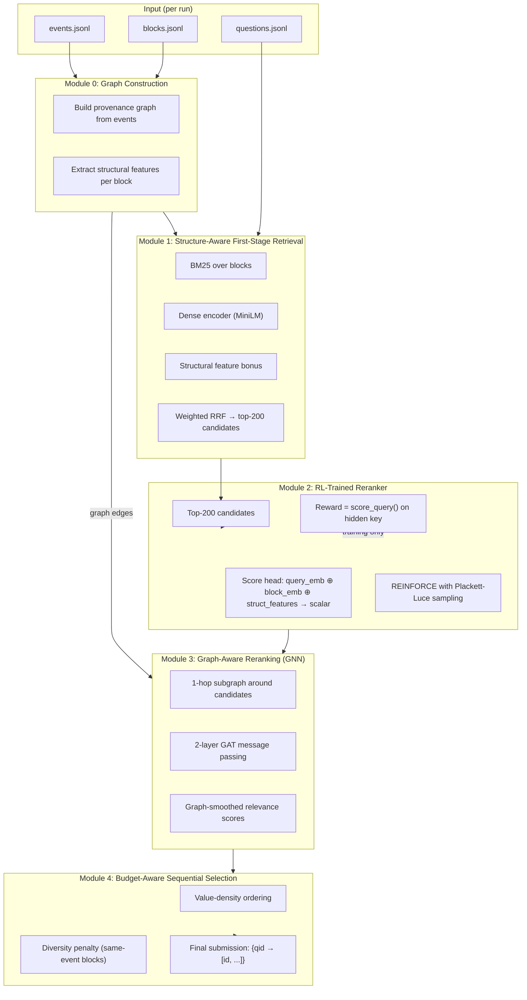

# RL-Based Retrieval for Multi-Agent Trajectories — Detailed Plan

## 1. Problem Statement

Teams of AI agents produce million-token conversation logs. When an agent needs to find what the team already did — a file location, a past decision, a prior failure — it faces a retrieval problem: which segments of the log answer the question?

**MultiAgent-IRBench** provides the evaluation framework: 10 runs × ~50 questions each = ~490 questions. For each question, a system must return a ranked list of event/block IDs. The benchmark scores this list under token budgets (1k / 2k / 4k / 8k), using a hidden graded answer key, with no model judge at test time.

---

## 2. Exact Input/Output Format

### What the system receives (per run)

Three JSONL/JSON files:

**`events.jsonl`** — one line per agent action (3k–5k events, 1–2M tokens total):
```json
{"id": "n000163", "agent": "oncall_triage", "kind": "model", "ts": 1790638165.197, "shift": 2, "conv": "c4623438...", "text": "Now I have a clear picture. Let me write my triage findings and send them to the commander.\n", "tokens": 21}
```

**`blocks.jsonl`** — sub-event chunks of ≤8 lines each (5k–10k blocks):
```json
{"id": "n003462/8eb830d98519e34f", "event": "n003462", "tokens": 27, "text": "/workspace/incidents/done/02/POSTMORTEM.md\n/workspace/incidents/done/01/POSTMORTEM.md"}
```

**`questions.jsonl`** — the questions to answer (~50 per run):
```json
{"qid": "a02", "question": "Where did the finished first incident end up, its postmortem and its done marker?", "qtype": "location", "asker": "commander"}
```

### What the system hands back

A single JSON file mapping each `qid` to a ranked list of IDs (whole events or individual blocks), best-first:

```json
{
  "a01": ["n003462/8eb830d98519e34f", "n000163", "n002501", "n001234/abcdef1234567890"],
  "a02": ["n003462", "n003100/9f3c1a2b5d6e7f80", "n002999"]
}
```

- A whole event ID like `"n003462"` costs all its tokens but earns the best value among its blocks.
- A block ID like `"n003462/8eb830d98519e34f"` costs only that block's tokens and earns only that block's value.
- Duplicates are worthless (max-per-nugget scoring).
- The scorer reads this list under each budget (1k/2k/4k/8k tokens), keeps the items that fit, looks each up in the hidden key, takes the best value per answer-nugget, and averages.

### Scoring (from [`bench/score.py`](file:///home/shrawani/Desktop/sem5/Information%20Retrieval%20and%20Extraction/project/MultiAgentData/bench/score.py))

```
score = mean over budgets of (sum of best-value-per-nugget / oracle-reachability-at-budget)
```

Credit values: **primary** = 1.0, **source** = 0.5, **relay** = 0.4, **path** = 0.15, **hub** = 0, **none** = 0. The "floor" (best query-blind strategy) is subtracted to report `above_floor`.

---

## 3. The Key Question: Can We Use Answer Keys for Training?

> [!IMPORTANT]  
> **The answer keys are NOT fed as input to the neural network.** They serve only as the **reward signal** during RL training — the same way a game score trains an RL agent without being part of the game state.

The separation is strict:

| | Training time | Inference time |
|---|---|---|
| **Model input** | question text + event/block texts + structural features | question text + event/block texts + structural features |
| **Answer key role** | Computes the scalar reward for a sampled ranking (via `score_query()`) | **Not available.** The trained model generalises from what it learned. |
| **What the model learns** | "Rankings where primary events appear near the top earn high rewards" → learns to recognise structural/textual signals that correlate with primary events | Applies learned signals to unseen questions on unseen (or same) runs |

This is standard RL practice: the reward function (game score, benchmark metric) guides learning but is never an input feature. The model never sees which specific IDs are correct — it only sees that some rankings score higher than others.

**Cross-validation protocol** (leave-one-run-out): Train on 9 runs (~440 questions), evaluate on the 1 held-out run (~50 questions). The held-out run has a different team architecture, different agents, different task domain — so the model must generalise structurally, not memorise ID→label mappings.

---

## 4. What Must Be Constructed: The Provenance Graph

> [!NOTE]
> **This section is self-contained.** It explains the graph from first principles — no prior knowledge of the benchmark codebase is assumed. A reader who has only seen the three input files described in Section 2 should be able to implement the graph builder from this section alone.

### 4.1 What the provenance graph is and why we need it

A **provenance graph** is a directed graph where:
- **Nodes** are events (agent messages, tool calls, tool outputs) — each identified by its `id` field in `events.jsonl` (e.g. `"n000163"`)
- **Edges** represent that information flowed from one event to another

Why build it? Because the benchmark's hidden answer key assigns credit based on the *role* each event played in the information chain:

```
tool_result (file read)  ──[file edge]──▶  model message (analysis)  ──[flow edge]──▶  model message (conclusion)
        ↑                                          ↑                                             ↑
    source (0.5 credit)                      relay (0.4 credit)                          primary (1.0 credit)
```

A text-only retriever can find the primary by matching query keywords to the agent's conclusion. But to also retrieve the source (the raw file read) and the relay (the intermediate analysis step), we need to know these events are connected — which is what the graph captures.

The graph is **not provided** in the public benchmark. We reconstruct it deterministically from the metadata and text patterns already in `events.jsonl`.

---

### 4.2 Understanding the event data

Every line of `events.jsonl` has these fields:

| Field | Type | Meaning | Example |
|-------|------|---------|---------|
| `id` | string | Unique event identifier | `"n000163"` |
| `agent` | string | Which agent produced this | `"oncall_triage"` |
| `kind` | enum | Type of event (3 values — see below) | `"model"` |
| `ts` | float | Unix timestamp (use for ordering) | `1790638165.197` |
| `shift` | int | Work shift number (0-based) | `2` |
| `conv` | string | Conversation thread ID — groups a tool_call with its tool_result, and sequential messages from one agent | `"c4623438..."` |
| `text` | string | Full content of this event | `"Now I have a clear picture..."` |
| `tokens` | int | Token count of `text` | `21` |

The `kind` field takes exactly three values — understanding them is critical:

| `kind` | Meaning | What the text contains |
|--------|---------|----------------------|
| `"model"` | The agent's own written message / reasoning | Plans, conclusions, summaries, instructions to other agents, analysis |
| `"tool_call"` | The agent invoked a tool | Structured call like `write_file(TargetFile="...", CodeContent="...")` or `run_command(CommandLine="cat /workspace/file.py")` |
| `"tool_result"` | The tool's response came back | File contents, command stdout/stderr, error messages |

**Key structural fact**: Every `tool_call` and its subsequent `tool_result` always share the same `conv` value. They are always paired.

---

### 4.3 Pre-processing: block normalisation and content hashing

Before building edges, prepare two things from `blocks.jsonl`:

**Block text normalisation** (for copy detection):
```python
import re

def normalise_line(line: str) -> str:
    """Remove leading line numbers (e.g. '42: ') and collapse whitespace."""
    line = re.sub(r"^\d+: ?", "", line)       # strip view_file line numbers
    return re.sub(r"\s+", " ", line).strip()
```

**Content hash** (SHA-1, 16 hex chars):
```python
import hashlib

def hash_block(block_text: str) -> str:
    normalised = normalise_line(block_text)
    return hashlib.sha1(normalised.encode()).hexdigest()[:16]
```

A block is **boilerplate** and must be excluded from copy detection if its hash appears in more than **12 different events** — these are repeated harness headers, status templates, or common output patterns that convey no information.

---

### 4.4 The five edge types: full construction details

#### Edge 1: `flow` — sequential conversation chain

**What it captures**: Within one conversation thread (`conv`), events follow a natural sequence. Agent reads tool output → writes next message → calls next tool. This temporal chain is information flow.

**Construction**:
1. Group all events by `conv` field
2. Within each group, sort by `ts` (ascending)
3. Connect each event to the next: `events[i]["id"] → events[i+1]["id"]`

```python
from collections import defaultdict

def build_flow_edges(events: list) -> list:
    by_conv = defaultdict(list)
    for e in events:
        by_conv[e["conv"]].append(e)
    edges = []
    for conv_events in by_conv.values():
        conv_events.sort(key=lambda e: e["ts"])
        for i in range(len(conv_events) - 1):
            edges.append((conv_events[i]["id"], conv_events[i+1]["id"]))
    return edges
```

**Precision**: ~100% (structural guarantee). **No false positives possible** — two consecutive events in the same conversation always represent sequential agent activity.

**Concrete example** (using the real event format from Section 2):
```
n000160  kind=model    "Let me check the postmortem file for incident 01."
  ──flow──▶
n000161  kind=tool_call  "view_file({\"AbsolutePath\": \"/workspace/incidents/done/01/POSTMORTEM.md\"})"
  ──flow──▶
n000162  kind=tool_result  "File Path: `.../POSTMORTEM.md`\n# Incident 01 Postmortem\n..."
  ──flow──▶
n000163  kind=model    "Now I have a clear picture. Let me write my triage findings..."
```

---

#### Edge 2: `result` — tool call to its direct output

**What it captures**: More specific than `flow` — directly links a `tool_call` to the exact `tool_result` that answered it.

**Construction**:
1. Process events in timestamp order
2. When you see `kind == "tool_call"`: record `pending[conv_id] = event_id`
3. When you see `kind == "tool_result"` with the same `conv_id`: emit edge `pending[conv_id] → current_event_id`, then clear pending

```python
def build_result_edges(events: list) -> list:
    pending = {}  # conv_id → tool_call event id
    edges = []
    for e in sorted(events, key=lambda e: e["ts"]):
        if e["kind"] == "tool_call":
            pending[e["conv"]] = e["id"]
        elif e["kind"] == "tool_result" and e["conv"] in pending:
            edges.append((pending.pop(e["conv"]), e["id"]))
    return edges
```

**Precision**: ~100%. **Concrete example**:
```
n000161  kind=tool_call   "view_file({\"AbsolutePath\": \"/workspace/incidents/done/01/POSTMORTEM.md\"})"
  ──result──▶
n000162  kind=tool_result  "File Path: `.../POSTMORTEM.md`\n# Incident 01 Postmortem\n..."
```

---

#### Edge 3: `file` — cross-agent information flow via the filesystem

**What it captures**: When Agent A writes a file and Agent B later reads it, real information has moved between agents. This is the most important inter-agent edge type — it directly encodes the source→relay→primary chain that earns credits of 0.5 and 0.4.

**Detecting writes**: A `tool_call` writes a file when its text contains a tool call with a `TargetFile` argument. The text format is `ToolName({json})`:

```python
import json, re

def parse_write_path(event: dict) -> str | None:
    """Return the file path written by this tool_call, or None."""
    if event["kind"] != "tool_call":
        return None
    text = event["text"]
    paren = text.find("(")
    if paren == -1:
        return None
    try:
        args = json.loads(text[paren + 1 : -1])
    except (ValueError, IndexError):
        return None
    return args.get("TargetFile")   # e.g. "/workspace/incidents/done/01/POSTMORTEM.md"
```

Also detect write confirmations from `tool_result` text starting with `"The following changes were made to"`:
```python
def parse_echo_path(event: dict) -> str | None:
    if event["kind"] != "tool_result":
        return None
    m = re.search(r"tool to: (\S+?)\.( If|$)", event["text"])
    return m.group(1) if m else None
```

**Detecting reads**: A `tool_result` is a file read when its text starts with `"File Path:"` — the standard header of the `view_file` tool:

```
File Path: `/workspace/incidents/done/01/POSTMORTEM.md`
Total Lines: 47
Showing lines 1 to 47
1: # Incident 01 Postmortem
...
```

```python
def parse_read_path(event: dict) -> str | None:
    if event["kind"] != "tool_result":
        return None
    if not event["text"].startswith("File Path:"):
        return None
    m = re.search(r"File Path: `([^`]+)`", event["text"])
    return m.group(1) if m else None
```

Also detect shell reads from `tool_call` commands like `cat`, `head`, `tail`, `grep`:

```python
SHELL_READ = re.compile(r"^\s*(cat|head|tail|sed|grep|less|git\s+(diff|show|log))\s")
PATH_IN_CMD = re.compile(r"(?:/workspace/)?((?:repo|tracker|board|notebooks|inbox|outbox|ci)/[\w./-]+\.\w+)")

def parse_shell_read_paths(event: dict) -> list:
    if event["kind"] != "tool_call":
        return []
    paren = event["text"].find("(")
    try:
        args = json.loads(event["text"][paren+1:-1])
    except (ValueError, IndexError):
        return []
    cmd = args.get("CommandLine", "")
    if not SHELL_READ.match(cmd):
        return []
    return PATH_IN_CMD.findall(cmd)
```

**Building file edges**:

```python
def build_file_edges(events: list) -> list:
    # Normalise paths: strip the /workspace/ prefix so Agent A's write at
    # /workspace/incidents/done/01/POSTMORTEM.md matches Agent B's read of the same relative path
    def norm(path: str) -> str:
        return path.split("/workspace/")[-1]

    last_write = {}   # normalised_path → event_id of last writer
    edges = []

    for e in sorted(events, key=lambda e: e["ts"]):
        # Check for writes
        for path in filter(None, [parse_write_path(e), parse_echo_path(e)]):
            last_write[norm(path)] = e["id"]

        # Check for reads
        read_paths = list(filter(None, [parse_read_path(e)])) + parse_shell_read_paths(e)
        for path in read_paths:
            np = norm(path)
            if np in last_write and last_write[np] != e["id"]:
                edges.append((last_write[np], e["id"]))

    return edges
```

**Precision**: 81% (blind audit of 272 pairs). **Concrete example**:
```
n002100  kind=tool_call   agent=commander
  "write_file({\"TargetFile\": \"/workspace/incidents/done/01/POSTMORTEM.md\", \"CodeContent\": \"# Incident 01...\"...})"
  ──file──▶
n003462  kind=tool_result   agent=reviewer
  "File Path: `.../POSTMORTEM.md`\n/workspace/incidents/done/02/POSTMORTEM.md\n/workspace/incidents/done/01/POSTMORTEM.md"
```
This is exactly the example from `blocks.jsonl`: `{"id": "n003462/8eb830d98519e34f", "event": "n003462", "tokens": 27, "text": "/workspace/incidents/done/02/POSTMORTEM.md\n/workspace/incidents/done/01/POSTMORTEM.md"}`.

---

#### Edge 4: `copy` — quoted or repeated content

**What it captures**: When an agent quotes, copies, or paraphrases a chunk of text from an earlier event, information has propagated. This catches the relay pattern: Agent A writes analysis → Agent B's handover note repeats the conclusion verbatim.

**Construction**:
1. For every block in `blocks.jsonl`, compute `hash_block(block["text"])`
2. Group blocks by hash: `{hash → list of (timestamp, event_id, block_id)}`
3. For each hash appearing in more than one event:
   - Find the earliest-timestamp event (the "source")
   - If the source event is `kind == "model"` or `kind == "tool_call"` (i.e., authored, not a raw external result)
   - And the block has ≥30 characters (too-short blocks are fragments)
   - And the hash appears in ≤12 different events (not boilerplate)
   - Then emit edge: source event → every later event containing the same block

```python
MIN_BLOCK_CHARS = 30
BOILERPLATE_THRESHOLD = 12

def build_copy_edges(events: list, blocks: list) -> list:
    event_ts   = {e["id"]: e["ts"]   for e in events}
    event_kind = {e["id"]: e["kind"] for e in events}

    # Group blocks by content hash
    by_hash = defaultdict(list)   # hash → [(ts, event_id)]
    for b in blocks:
        if len(b["text"]) < MIN_BLOCK_CHARS:
            continue
        h = hash_block(b["text"])
        eid = b["event"]
        by_hash[h].append((event_ts.get(eid, 0), eid))

    edges = []
    for h, occurrences in by_hash.items():
        if len(occurrences) > BOILERPLATE_THRESHOLD:
            continue   # appears too often — boilerplate
        occurrences.sort(key=lambda x: x[0])   # earliest first
        first_ts, first_eid = occurrences[0]
        if event_kind.get(first_eid) not in ("model", "tool_call"):
            continue   # source must be authored content
        for later_ts, later_eid in occurrences[1:]:
            if later_eid != first_eid:
                edges.append((first_eid, later_eid))
    return edges
```

**Precision**: 77% (blind audit). **Concrete example**:
```
n001500  kind=model   agent=oncall_triage
  "...The root cause is a race condition in the lock acquisition path..."
  ──copy──▶
n002800  kind=model   agent=commander
  "Summary for next shift: root cause is a race condition in the lock acquisition path..."
```

---

#### Edge 5: `ref` — locator pointer following

**What it captures**: When Agent A first introduces a specific identifier — a file path, issue number, commit hash, branch name, test name, or error type — and Agent B later uses the same identifier, B is working from A's information.

**What counts as a locator** (specific enough to be meaningful, not so common as to be noise):

| Locator kind | Regex | Example match |
|-------------|-------|--------------|
| `path` | `(?:/workspace/)?(repo\|tracker\|board\|notebooks\|...)/[\w./-]+\.\w+` | `repo/dateutil/parser.py` |
| `issue` | `(?:#\|issues?/\|pulls?/\|PR ?#?\|issue ?#?)(\d{3,4})\b` | `#274` |
| `branch` | `\b((?:fix\|feat\|update\|chore\|docs\|ci\|release)[-/][\w.-]{3,60})\b` | `fix/race-condition-lock` |
| `commit` | `\b([0-9a-f]{7,40})\b` where match has both `[a-f]` and `\d` | `a3f1b2c` |
| `test` | `\b(test_\w{4,}\|Test\w{4,})\b` | `test_parse_dateutil` |
| `error` | `\b(\w+(?:Error\|Exception\|Warning)\b[^\n]{0,60})` | `ThreadingError: deadlock detected` |

```python
LOCATOR_PATTERNS = {
    "path":   re.compile(r"(?:/workspace/)?((?:repo|tracker|board|notebooks|inbox|outbox|ci)/[\w./-]+\.\w+)"),
    "issue":  re.compile(r"(?:#|issues?/|pulls?/|PR ?#?|issue ?#?)(\d{3,4})\b", re.I),
    "branch": re.compile(r"\b((?:fix|feat|update|chore|docs|ci|release)[-/][\w.-]{3,60})\b"),
    "commit": re.compile(r"\b([0-9a-f]{7,40})\b"),
    "test":   re.compile(r"\b(test_\w{4,}|Test\w{4,})\b"),
    "error":  re.compile(r"\b(\w+(?:Error|Exception|Warning)\b[^\n]{0,60})"),
}

def extract_locators(text: str) -> set:
    found = set()
    for kind, pattern in LOCATOR_PATTERNS.items():
        for m in pattern.findall(text):
            val = m if isinstance(m, str) else m[0]
            if kind == "commit":
                # Commit hashes must contain both hex letters AND digits
                if not (re.search(r"[a-f]", val) and re.search(r"\d", val)):
                    continue
            found.add((kind, val.strip()[:70]))
    return found
```

**Building ref edges** (with two key filters):

```python
COMMON_LOCATOR_THRESHOLD = 15   # locators in >15 events are too generic (e.g. "repo/README.md")
LISTING_THRESHOLD = 15          # events that introduce >15 locators are indices/listings, not sources

def build_ref_edges(events: list) -> list:
    # Count how often each locator appears across all events
    loc_count = defaultdict(int)
    for e in events:
        for loc in extract_locators(e["text"]):
            loc_count[loc] += 1
    common = {loc for loc, n in loc_count.items() if n > COMMON_LOCATOR_THRESHOLD}

    # First mention → all later mentions
    first_mention = {}   # locator → event_id
    edges = []

    for e in sorted(events, key=lambda e: e["ts"]):
        locs = extract_locators(e["text"]) - common
        if len(locs) > LISTING_THRESHOLD:
            continue   # this event is a directory listing / index — not a real information source
        for loc in locs:
            if loc not in first_mention:
                first_mention[loc] = e["id"]
            elif first_mention[loc] != e["id"]:
                edges.append((first_mention[loc], e["id"]))
    return edges
```

**Precision**: 70% (blind audit). **Concrete example**:
```
n000050  kind=model   agent=lead
  "...we need to fix issue #274, which relates to file repo/dateutil/parser.py..."
  ──ref──▶
n001800  kind=tool_call   agent=area_owner
  "view_file({\"AbsolutePath\": \".../repo/dateutil/parser.py\"})"
  ──ref──▶
n002300  kind=model   agent=reviewer
  "...I've reviewed the fix for issue #274 and it looks correct..."
```

---

### 4.5 Edges we deliberately exclude

Two additional edge types were evaluated and **rejected** — do not implement them:

| Edge type | Mechanism | Measured precision | Why excluded |
|-----------|-----------|-------------------|-------------|
| **near-copy** | Shared rare 8-word spans between different blocks | **27%** | Coincidental phrase overlap creates far more false edges than true ones |
| **semantic** | MiniLM cosine similarity ≥ 0.80 between blocks in an author's ancestry | **15%** | High embedding similarity does not reliably indicate information flow |

Including either would cause the GNN (Module 3) to propagate relevance scores across false edges, degrading performance.

---

### 4.6 Graph features extracted per block (the 15-dimensional structural input to the RL model)

After building all edges, compute one 15-d float32 vector per block. These feed directly into the RL reranker's structural projection layer.

| Index | Feature name | Computation | Why it matters for retrieval |
|-------|-------------|-------------|------------------------------|
| 0 | `tokens_log` | `log(1 + block["tokens"])` | Smaller blocks are budget-efficient — prefer them for tight budgets |
| 1 | `text_len_log` | `log(1 + len(block["text"]))` | Proxy for information density within a block |
| 2 | `kind_is_model` | `1.0 if event["kind"] == "model" else 0.0` | Model messages are most often primaries (1.0 credit) |
| 3 | `kind_is_tool_call` | `1.0 if event["kind"] == "tool_call" else 0.0` | Tool calls are where work was commanded |
| 4 | `kind_is_tool_result` | `1.0 if event["kind"] == "tool_result" else 0.0` | Tool results are common sources (0.5 credit) |
| 5 | `shift` | `float(event["shift"])` | Later shifts tend to have more final/complete answers |
| 6 | `position_frac` | `rank_by_ts / max(1, total_events - 1)` ∈ [0, 1] | Later in run = more likely to hold conclusions |
| 7 | `in_degree` | Count of all edges pointing **into** this event | Many things led here → important synthesis or summary point |
| 8 | `out_degree` | Count of all edges pointing **out of** this event | This event influenced many others → key source of information |
| 9 | `has_file_write` | `1.0 if event["id"] in file_write_sources else 0.0` | Wrote a file → the information originated here |
| 10 | `has_file_read` | `1.0 if event["id"] in file_read_targets else 0.0` | Read a file that was written by another agent → cross-agent flow |
| 11 | `has_path` | `1.0 if PATH_RE.search(block["text"]) else 0.0` | Contains a file path → likely locator-bearing, important for location questions |
| 12 | `has_code` | `1.0 if CODE_RE.search(block["text"]) else 0.0` | Contains code → tool_call or code output |
| 13 | `conv_agent_count` | `float(len(agents_by_conv[event["conv"]]))` | Multi-agent conv → information crossing agent boundaries |
| 14 | `is_copy_target` | `1.0 if event["id"] in copy_targets else 0.0` | This event was quoted by a later one → information flowed through it |

```python
PATH_RE = re.compile(r"(?:/workspace/)?[\w-]+/[\w./-]+\.\w+")
CODE_RE = re.compile(r"\b(def|class|import|from|return|if|else|elif|for|while)\b|```")
```

---

### 4.7 Complete build_graph() interface

The graph builder wraps all the above into a single function:

```python
def build_graph(events: list, blocks: list) -> dict:
    """
    Build provenance graph from raw events.jsonl and blocks.jsonl records.

    Args:
        events: list of dicts, one per event (id, agent, kind, ts, shift, conv, text, tokens)
        blocks: list of dicts, one per block  (id, event, tokens, text)

    Returns dict with keys:
        edges            : {edge_type: [(src_event_id, dst_event_id), ...]}
                           edge_type ∈ {"flow", "result", "file", "copy", "ref"}
        in_degree        : {event_id: int}   — total incoming edges across all types
        out_degree       : {event_id: int}   — total outgoing edges across all types
        file_write_sources: set of event_ids that wrote files (file edge sources)
        file_read_targets : set of event_ids that read files  (file edge targets)
        copy_targets      : set of event_ids that received copied content
        temporal_frac     : {event_id: float} — position 0.0 (earliest) to 1.0 (latest)
        agents_by_conv    : {conv_id: set of agent names in that conversation}
    """
```

**Runtime**: ~5 seconds for a 4,000-event run. No GPU, no model calls.

---

### 4.8 What the graph gives us at a glance

| Graph signal | Retrieval implication |
|-------------|----------------------|
| Event A `──file──▶` Event B | B likely read what A wrote; B may be a source (0.5) for the same question that A is a primary for |
| Event A `──ref──▶` Event B | B is working from A's locator; B may be on the same answer chain |
| Event A `──copy──▶` Event B | B relayed A's content; both contribute to the same nugget |
| Event B has high in-degree | Many things led to B; it's either a key synthesis point or a hub (check text to distinguish) |
| Event A has `kind == "model"`, high out-degree, high `position_frac` | Strong prior that A is a primary event |
| Event A has `kind == "tool_result"`, `has_file_read = 1`, and a `file` edge into a high-scoring event | Strong prior that A is a source event worth retrieving |

---

## 5. Existing Baselines (What We Must Beat)

From [`bench/baselines.py`](file:///home/shrawani/Desktop/sem5/Information%20Retrieval%20and%20Extraction/project/MultiAgentData/bench/baselines.py):

| Method | Mechanism | Score range | Above floor |
|--------|-----------|------------|-------------|
| **Fusion** (BM25 + Dense RRF) | Reciprocal rank fusion of BM25 and MiniLM cosine | 0.30–0.50 | +0.15–0.40 |
| **BM25** | Okapi BM25 with default k1=1.2, b=0.75 | 0.20–0.40 | +0.10–0.30 |
| **Dense** (MiniLM) | `paraphrase-multilingual-MiniLM-L12-v2` cosine similarity | 0.20–0.40 | +0.10–0.30 |
| **Query-blind floor** | Best of: most-connected, newest, cheapest messages, random, file ops, smallest blocks | 0.04–0.13 | 0 |

**Gap analysis**: The fusion baseline ignores all structural information — it treats events as flat text bags. It doesn't know that a `tool_result` showing a file read is a likely source (0.5 value), that `model` messages discussing specific entities are likely primaries (1.0 value), or that events connected by file-write→read edges form information chains. Our method exploits all of these.

---

## 6. System Architecture: Four Progressive Modules



---

## 7. Module Details

### Module 0: Graph Construction (deterministic, no ML)

**What it does**: Reconstructs the provenance graph from raw `events.jsonl` data — the same graph that would have been in `graph.json` if it were provided.

**Inputs**: `events.jsonl`, `blocks.jsonl`  
**Outputs**: Edge lists `{type: [(src_id, dst_id), ...]}`, per-event degree/membership features, block-to-event mapping

**Algorithm**: As described in Section 4. Key steps:
1. Parse event text to detect file paths (writes in `tool_call` args, reads in `tool_result` headers)
2. Group events by conversation (`conv` field) for flow/result edges
3. Hash normalised block text for copy detection
4. Extract locators (paths, issues, branches, commits, errors) for ref edges
5. Compute graph features: degrees, edge membership flags, conversation metrics

**Why this is possible from just events.jsonl**: All the information needed is in the event text and metadata fields (`conv`, `kind`, `ts`, `agent`). The original `graph.json` was built from `events_ts.jsonl` using exactly the same logic — we just re-implement it.

**No model calls. ~5 seconds per run.**

---

### Module 1: Structure-Aware First-Stage Retrieval

**What it does**: Replaces naive BM25+Dense fusion with a retriever that knows about agent roles, event types, and graph position. Produces top-200 candidates per question.

**What gap it covers vs. baselines**: The fusion baseline treats every text chunk equally. But in agent trajectories:
- `model` messages where the agent reasons are much more likely to be primaries (1.0 credit) than `tool_result` outputs
- Events with file-write edges are likely sources (0.5 credit) — they're where work happened
- Events with high graph degree are hubs — connected but uninformative (0.0 credit)
- Late-run events are more likely to contain final answers than early ones

**Mechanism**: Weighted reciprocal rank fusion across three signals:
1. **BM25** (lexical): catches exact terms, file paths, error messages
2. **Dense** (MiniLM cosine): catches semantic similarity, paraphrases
3. **Structural bonus**: learned weights over graph/metadata features

The structural bonus for each block:
```
bonus = w₁·kind_is_model + w₂·has_file_write_edge + w₃·has_file_read_edge + w₄·min(1, degree/10) + w₅·position_frac
```

Weights learned by grid search on training runs (maximise Recall@200 of primary events).

**Inputs**: Block texts, question text, graph features  
**Outputs**: Top-200 candidate block/event IDs per question

---

### Module 2: RL-Trained Reranker (Core Contribution)

**What it does**: Takes top-200 candidates and learns to rank them by directly optimising the benchmark's non-differentiable graded coverage metric.

**What gap it covers**: Standard rerankers use pointwise cross-entropy or pairwise margin losses — these are **proxies** for the actual metric. The benchmark's metric is specifically designed to resist gaming (budget constraints, max-per-nugget, oracle normalisation). Proxy losses don't capture the budget/diversity trade-off. RL lets us optimise the real thing.

**Architecture**: A lightweight scoring head (no LLM fine-tuning):

```
Input per candidate:
  query_embedding (384-d, from frozen MiniLM)
  block_embedding (384-d, from frozen MiniLM)
  structural_features (15-d, from Module 0)

Score head:
  [query_emb ⊕ block_emb ⊕ Linear(struct_features → 64-d)]  (832-d)
  → Linear(832, 256) → ReLU → Dropout(0.1) → Linear(256, 1) → scalar score
```

Total trainable parameters: ~215K (the MiniLM encoder is frozen — saves VRAM on the RTX 3050).

**Training algorithm** (REINFORCE with Plackett-Luce):

```
For each training question:
  1. Compute scores for all 200 candidates: s = ScoreHead(q_emb, c_emb, struct)
  2. Sample K=32 random rankings via Plackett-Luce:
     - Iteratively sample from softmax(s/τ) over remaining candidates
     - Record log-probability of the sampled permutation
  3. For each sampled ranking, compute reward:
     reward = score_query(answer_key_entry, ranked_ids, tokens_map)["score"]
     (This calls the benchmark's own scorer — the exact metric we want.)
  4. REINFORCE update:
     loss = -mean((reward - baseline) × log_prob)
     baseline = EMA of past rewards (momentum 0.99)
  5. Backprop, clip gradients, step optimizer
```

**Temperature annealing**: τ starts at 1.0 (exploratory), decays linearly to 0.1 (near-deterministic) over 80 epochs. This balances exploration (trying diverse rankings to discover what scores well) with exploitation (converging on a good ranking policy).

**Crucially**: The answer key is used ONLY to compute the scalar reward. The model's input features are always the same: text embeddings + structural features. At inference time, the model ranks candidates by their learned scores — no key needed.

---

### Module 3: Graph-Aware Reranking (GNN)

**What it does**: Uses the provenance graph to rescue events that have low text similarity to the query but sit on the information chain to the answer.

**What gap it covers**: Text-based retrieval (Modules 1–2) can find the primary event where the answer was stated. But the benchmark also credits **source** events (0.5) — the tool result or file read that brought the raw information — and **relay** events (0.4) — intermediate steps that carried the information. These are connected to the primary by graph edges but may have very different text. A GNN can propagate relevance scores along these edges.

**Example**: Question asks "Where is the postmortem for incident 1?" The primary event (1.0 credit) is an agent message saying "The postmortem is at /workspace/incidents/done/01/POSTMORTEM.md". The source event (0.5 credit) is a `tool_result` from `cat /workspace/incidents/done/01/POSTMORTEM.md` — the actual file content. A text retriever finds the primary easily but may miss the source. A GNN sees the `file` edge from source→primary and boosts the source's score.

**Architecture**: 2-layer Graph Attention Network (GAT):
1. Build subgraph: take top-200 candidates from Module 2, expand to 1-hop graph neighbours
2. Node features: MiniLM embedding (384-d) + structural features (15-d) → projected to 128-d
3. GAT layers: 4-head attention, residual connections, ~100K parameters
4. Output: per-node relevance score, combined with Module 2 score via learned weight

**Fallback**: If PyTorch Geometric is not installed, a simple manual attention mechanism over the adjacency matrix (standard PyTorch only).

**Training**: Same RL reward signal as Module 2. The GNN is trained jointly or sequentially.

---

### Module 4: Budget-Aware Sequential Selection

**What it does**: Given the reranked scores, produces the final submission that maximises coverage under the budget constraints.

**What gap it covers**: Naively listing candidates by score wastes budget. A 500-token event with one nugget pushes out two 100-token blocks that each cover a different nugget. Since the benchmark averages over budget tiers (1k/2k/4k/8k), the ordering must be efficient at all tiers simultaneously.

**Mechanism**: Two strategies, selected by the system:
1. **Value-density ordering**: Sort by `score / max(tokens, 64)` — puts small, high-value blocks first. This is optimal for the smallest budget tiers.
2. **Diversity penalty**: After selecting a block, penalise other blocks from the same event (they likely cover the same nugget — max-per-nugget means duplicates are worthless). First block from an event: full score. Second block: 0.5× score. Third+: 0.25× score.

**No ML required** — this is a deterministic post-processing step.

---

## 8. Literature and Gap Coverage

For each paper: what we use from it, and what specific gap in existing baselines it addresses.

### Papers directly incorporated into the design

| # | Paper | Year | What we use | Gap covered |
|---|-------|------|-------------|-------------|
| 1 | **Neural PG-RANK** (Oosterhuis) | 2021 | Plackett-Luce ranking policy trained with REINFORCE for direct metric optimisation | **Gap: Non-differentiable metric.** Existing baselines use BM25/cosine scores that are proxies for the actual graded-coverage metric. PG-RANK lets us optimise the real `score_query()` metric directly via policy gradients, bypassing the proxy mismatch. |
| 2 | **LRAT — Learning to Retrieve from Agent Trajectories** (Zhou et al., arXiv 2604.04949) | 2026 | Agent behavioural signals as retrieval features: what was browsed (opened/read), what was acted on (written after reading), unbrowsed items as hard negatives | **Gap: Ignoring agent behaviour.** Text-only retrievers treat agent messages and tool outputs identically. LRAT showed that "what the agent opened and then quoted" is a powerful relevance signal. We use the equivalent: `file` edges (write→read), `flow` edges (reasoning after reading), and event `kind` as structural features. |
| 3 | **G-RAG** (Kim et al.) | 2024 | GNN-based reranking over document graphs using Graph Attention Networks | **Gap: Isolated chunk scoring.** Fusion treats each block independently. But answer events are connected to their sources and relays by provenance edges. G-RAG showed that GNN reranking over document affinity graphs can rescue related passages that lack direct query overlap. We apply this to the provenance graph, which is higher quality (70-81% precision edges vs. automatically constructed graphs). |
| 4 | **R3-RAG** (Liu et al.) | 2025 | Dual-reward RL framework for retrieval: outcome reward (final score) + process reward (intermediate relevance) | **Gap: No reward signal for intermediate steps.** The benchmark scores the final ranked list, but the RL agent must learn to value individual selections. R3-RAG's dual reward design informs our reward shaping: the primary reward is `score_query()`, and the structural features provide implicit process signals. |
| 5 | **GR² — Generative Retrieval Meets Multi-Graded Relevance** | 2025 | Graded relevance values directly incorporated into RL reward shaping | **Gap: Binary relevance assumption.** Standard contrastive training treats all relevant docs equally. But the benchmark has 5 graded levels (1.0/0.5/0.4/0.15/0.0). GR² showed that RL with graded rewards significantly outperforms binary training on graded benchmarks. Our reward inherits the benchmark's grading naturally. |
| 6 | **ISETrace — When Does Execution Provenance Help Agent Memory Retrieval?** (Wang et al., arXiv 2609.25913, WSDM 2027) | 2026 | Provenance-unit retrieval from agent traces; Full Support as a metric; field-aligned units (events/blocks) beat fixed windows by 16–19 points | **Gap: Fixed-window chunking.** Using blocks (≤8 lines, field-aligned) rather than arbitrary fixed-size windows is validated by ISETrace's finding that provenance-aligned units outperform windows. Their null result for graph walk (worse than plain dense) also confirms that naive BFS over the graph is not enough — a learned GNN is needed. |

### Papers informing the design (not directly implemented but shaping decisions)

| # | Paper | What we learn | Design implication |
|---|-------|--------------|-------------------|
| 7 | **SynthKGQA** (Cattaneo et al., arXiv 2511.04473) | Shortest paths from seed to answer are a bad proxy for the real reasoning path (costs 4–36% at 4+ hops). Validation-by-execution catches wrong reference answers. Structure-stratified reporting exposes failures aggregate numbers hide. | We do NOT use shortest-path credit as a feature (confirmed harmful). We DO stratify results by `spread` (one/several events) and `agents` (one/several agents). |
| 8 | **Alpha-nDCG** (Clarke et al., 2008) | Redundancy in ranked lists must be penalised | Already built into the benchmark (max-per-nugget). Informs our Module 4 diversity penalty — returning copies of the same information earns nothing. |
| 9 | **AutoNuggetizer** (Pradeep et al., arXiv 2504.15068) | Atomic information unit (nugget) evaluation enables graded, multi-faceted scoring | Validates the benchmark's design. Our method targets nugget-level coverage, not document-level relevance. |
| 10 | **Cormack & Grossman TAR** (SIGIR 2016) | Recall estimation via target method — independent random sample | Informs our cross-validation confidence: with 50 questions per held-out run, we can bound generalisation error. Not used in the retrieval system itself. |

---

## 9. Training Data and Cross-Validation

### Available data

| Run | Domain | Events | Tokens | Questions | Agents | Floor |
|-----|--------|--------|--------|-----------|--------|-------|
| r1 | Library maintainers | 3,595 | 0.99M | 42 | 10 | 0.061 |
| f2 | Debate panel | 3,490 | 1.83M | 50 | 6 | 0.050 |
| g2 | Literature review | 3,032 | 1.22M | 49 | 5 | 0.127 |
| g3 | On-call engineers | 4,316 | 1.44M | 50 | 7 | 0.098 |
| g4 | Help desk | 4,672 | 1.17M | 50 | 6 | 0.039 |
| g5 | City data analysts | 4,308 | 1.26M | 49 | 7 | 0.106 |
| g6 | Due diligence | 3,376 | 1.13M | 50 | 5 | 0.106 |
| g8 | Online shop | 4,003 | 1.41M | 50 | 5 | 0.077 |
| g9 | Executive assistants | 4,321 | 1.15M | 50 | 5 | 0.102 |
| g10 | Textbook team | 2,581 | 1.14M | 50 | 8 | 0.058 |
| **Total** | | **37,694** | **12.7M** | **490** | | |

### Leave-one-run-out protocol (10 folds)

Each fold: train on 9 runs (~440 questions), test on 1 held-out run (~50 questions). The held-out run has a different team shape, different task domain, and different agent population — this tests whether the method generalises structurally rather than memorising run-specific patterns.

The reward signal during training comes from the `answer_key.json` files of the 9 training runs. The held-out run's key is used only for final evaluation.

---

## 10. File Structure (Modular Library)

```
method/
├── __init__.py               # Package definition
├── config.py                 # All paths, hyperparameters, constants
├── graph_builder.py          # Module 0: Provenance graph construction from events.jsonl
├── features.py               # Structural feature extraction (per block/event)
├── first_stage.py            # Module 1: BM25 + Dense + structural fusion
├── reranker.py               # Module 2: RL-trained reranker model (nn.Module)
├── rl_trainer.py             # Module 2: REINFORCE training loop
├── gnn_reranker.py           # Module 3: GAT graph reranker
├── budget_selector.py        # Module 4: Budget-aware selection + diversity
├── pipeline.py               # End-to-end: load run → build graph → retrieve → rerank → submit
├── train.py                  # Training harness (leave-one-run-out CV)
├── evaluate.py               # Evaluation: score submissions, ablations, strata reports
├── checkpoints/              # Saved model weights
├── results/                  # Score reports, ablation tables
└── README.md                 # Usage instructions
```

---

## 11. Expected Outcomes and Ablation Plan

### Expected scores (hypothesis)

| Configuration | Expected score | Expected above-floor |
|--------------|---------------|---------------------|
| Fusion baseline (existing) | 0.30–0.50 | +0.15–0.40 |
| Module 0+1 (graph features + structural fusion) | 0.35–0.55 | +0.20–0.45 |
| + Module 2 (RL reranker) | 0.45–0.65 | +0.30–0.55 |
| + Module 3 (GNN) | 0.48–0.68 | +0.33–0.58 |
| Full system (+ Module 4 budget-aware) | 0.50–0.70 | +0.35–0.60 |

### Ablation experiments

1. **Structural features only** (no RL): Measure the gain from graph-derived features alone
2. **RL with text only** (no structural features): Isolate the contribution of RL training vs. structural knowledge
3. **RL without GNN**: Measure the marginal gain from graph message passing
4. **Budget-aware vs. naive ordering**: Measure the gain from value-density + diversity selection
5. **Per-stratum analysis**: Score by `spread` (one event / several events) × `agents` (one agent / several agents) — the GNN should help most on "several events, several agents" questions

### Verification

```bash
# Score a submission against the hidden key
python3 bench/score.py runs/<name>/answer_key.json submission.json \
    --events runs/<name>/events.jsonl --blocks runs/<name>/blocks.jsonl

# Compare our method vs. all baselines on a run
python3 method/evaluate.py --run g3 --compare bench/g3/sub_fusion.json
```

---

## 12. Compute Requirements (RTX 3050 4GB)

| Component | VRAM | Time per run |
|-----------|------|-------------|
| MiniLM encoding (corpus) | ~1 GB | 2–5 min |
| Graph construction | 0 (CPU) | ~5 sec |
| Feature extraction | 0 (CPU) | ~2 sec |
| RL reranker training (per epoch, all questions) | ~0.5 GB | ~30 sec |
| GNN training (per epoch) | ~0.3 GB | ~10 sec |
| **Total training (80 epochs, 9 runs)** | **~1.5 GB peak** | **~1–2 hours** |
| **Inference (one run, 50 questions)** | **~1 GB** | **~3 min** |

Well within the RTX 3050's capabilities. The MiniLM encoder (33M params) is frozen, so no backward pass through it — only the ~315K trainable parameters (score head + GNN) need gradients.

---

## 13. Implementation Order

1. **Module 0: Graph Builder** (~1 day) — re-implement `build_graph.py` logic as a clean library function
2. **Module 0+1: Features + First-Stage** (~2 days) — feature extraction + structural fusion, immediate measurable gain
3. **Module 2: RL Reranker** (~3 days) — the core research contribution
4. **Module 3: GNN** (~2 days) — lightweight graph extension
5. **Module 4: Budget Selector** (~0.5 day) — simple post-processing
6. **Pipeline + Evaluation** (~1 day) — end-to-end integration, cross-validation
7. **Ablations + Report** (~1.5 days) — tables, figures, per-stratum analysis

**Total: ~11 days**

---

## 14. Dependencies

```
torch>=2.0
sentence-transformers>=2.2
torch-geometric>=2.4        # Optional: only for Module 3 GNN (has CPU fallback)
tiktoken                     # Token counting (already used in the repo)
numpy
scikit-learn                 # Grid search for Module 1 structural weights
```
