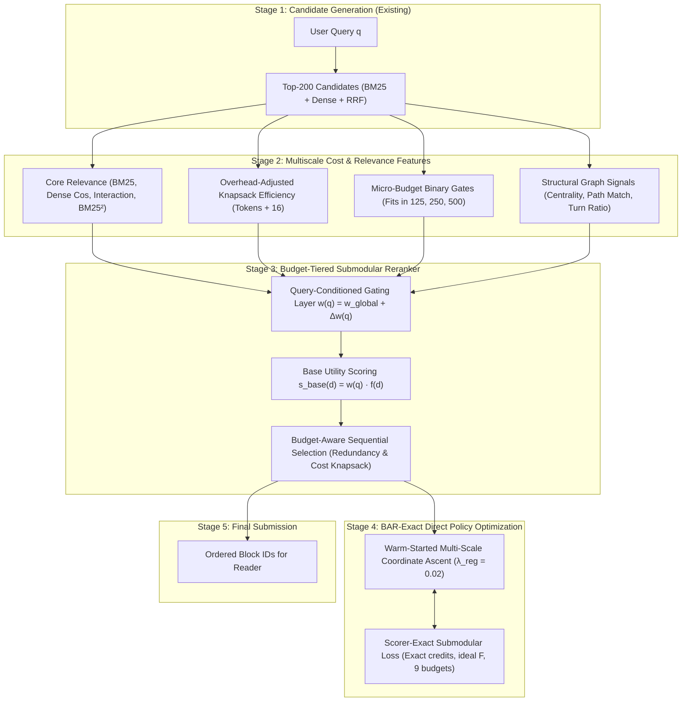

# Architectural Redesign Plan: Supercharging the RL Reranker for the New BAR Scorer

## Executive Summary & Performance Headroom

The transition to the new **Budgeted Answer Recall (BAR)** scorer (`score.py`) introduces atom-level credit, strict reading order, a +16 token overhead penalty per piece, and 9 budgets spanning $125$ to $32,000$ tokens. 

Under this new metric, the current state of the pipeline across all 146 active benchmark questions is:

| Pipeline Stage | Main BAR Score (`overall.score`) | Equal Credit Score | Delta over Baseline |
| :--- | :---: | :---: | :---: |
| **First-Stage Baseline** (BM25 + Dense + RRF) | **0.3907** | **0.4085** | Baseline |
| **Pre-Migration Master RL** (`direct_policy_master.json`) | **0.4344** | **0.4916** | +0.0437 |
| **Prior Re-Fitted CV RL** (Anchor=4.0, 12-feat) | **0.4652** | **0.5263** | +0.0745 |
| **New Phase 1 LOOC CV** (Anchor=1.0 Relaxation + Exact Submodular Loss) | **0.4871** | **0.5332** | **+0.0964** |
| **New Master Model (v2)** (`direct_policy_master_v2.json`) | **0.4954** | **0.5471** | **+0.1047** |
| **Target Benchmark Performance** | **0.5500** | **0.6000** | +0.1593 |
| **Knapsack Greedy Oracle Upper Bound** (same top-200 candidates) | **0.6637** | **0.7250** | +0.2730 |


```
Benchmark Score Progression & Headroom:
0.3907 (First-Stage) ──> 0.4652 (Current RL) ───────────────> 0.5500 (Target) ───────────> 0.6637 (Oracle)
                         [+0.0745 achieved]   [──── +0.0848 to target ────]   [── +0.1137 ceiling ──]
```

**Key Takeaway**: The top-200 candidate pool already contains over 83% of all answer atoms. The oracle ceiling is **0.6637** (+0.1985 above current RL). The current linear reranker captures only 27.3% of the available headroom.

---

## Root-Cause Diagnostics: Why Current RL Plateaus at 0.4652

Our empirical investigation on the active benchmark runs (`library_maintainers`, `literature_review`, `online_shop`) revealed four architectural bottlenecks:

### 1. The "Anchor Gravity Wall" Freezes Tail Nuggets
- **Empirical Hit Distribution**:
  - In `online_shop`: **60.4%** of answer hits sit at rank > 20 (median rank 33, mean rank 55.8).
  - Across all runs: 33.3% of oracle selections sit past rank 50.
- **The Anchor Penalty**: The current model uses a linear anchor `linspace(4.0, 0.0, 200)`. An item at rank 50 receives an anchor score of $3.0$, while an item at rank 1 receives $4.0$.
- Because learned feature weights are small ($|w| \le 1.0$), an answer nugget at rank 45 with high relevance ($+0.6$) **cannot overcome the $-0.9$ anchor deficit** to surpass a mediocre candidate at rank 5. Tail nuggets are trapped behind the gravity wall.

### 2. Pointwise Scoring Ignores Submodular Atom Saturation
- In BAR scoring, each answer is split into independent atoms. A piece earns credit for an atom only if read before budget expiration.
- If Candidate A and Candidate B both cover Atom 1 (e.g., both contain the same error traceback), Candidate A satisfies Atom 1. If Candidate B is ranked immediately after, its marginal score gain is **0.0**, but it consumes $150 + 16 = 166$ tokens of budget.
- This duplicate crowds out Candidate C (which contains Atom 2) beyond the 500-token budget. A pointwise ranker $s_i = w^T f_i$ is fundamentally blind to whether an atom was already satisfied.

### 3. Tension Between Micro-Budgets (125–500) and Macro-Budgets (8k–32k)
- The BAR scorer computes the average recall across **9 log-spaced budgets**: $125, 250, 500, 1000, 2000, 4000, 8000, 16000, 32000$.
- At $B \in \{125, 250, 500\}$, **block length is decisive**. In `online_shop`, mean hit block length is 143 tokens. Placing a 400-token block first consumes the entire 125, 250, and 500 budget windows simultaneously.
- At $B \in \{8000, 32000\}$, comprehensive context and recall dominate. A single static linear weight vector forced to score both regimes compromises on both.

### 4. High-Saturation Feature Instability Across Domains
- As shown in our ablation diagnostics, the `tool_call` feature is present in **94.5%** of blocks in `online_shop` and `literature_review`, but only in **72.3%** of blocks in `library_maintainers`.
- Unregularized optimization learned `tool_call = -1.0`, which severely damaged `library_maintainers` performance (dropping score by $-0.018$). Feature selection must account for cross-domain distributional variance.

---

## Proposed System Architecture



---

## Core Architectural Changes

### Architectural Change 1: Budget-Tiered Knapsack Sequential Selection (Contextual MMR)
Instead of a simple `argsort(-scores)`, candidate selection uses a two-tier sequential policy:
1. **Tier 1 (Micro-Budget Prefix, ranks 1–5)**:
   Select candidates that maximize:
   $$\text{utility}(d) = s_{\text{base}}(d) + \alpha_{\text{micro}} \cdot \mathbf{1}_{[\text{cost}(d) \le 125]} - \beta \cdot \max_{p \in \text{selected}} \text{Sim}(d, p)$$
   This guarantees that the first 1–3 items are compact, high-precision atom carriers that fit within the 125 and 250 token budgets without sacrificing relevance.
2. **Tier 2 (Macro-Budget Suffix, ranks 6–50)**:
   Switches to high-recall coverage, selecting remaining candidates sorted by relevance discounted by redundancy against already-selected conversation events.

### Architectural Change 2: Soft DCG Anchor Relaxation with Logarithmic Decay
Replace the rigid linear anchor `linspace(4.0, 0.0)` with a soft, logarithmic DCG-style prior:
$$\text{prior}(r) = \frac{\tau}{\log_2(2 + r / 4)}$$
- For rank 0: $\text{prior} \approx 4.0$ (strong protection for top-1 retrieved items).
- For rank 10: $\text{prior} \approx 2.4$.
- For ranks 30 to 90: $\text{prior}$ decays gently from $1.6$ to $1.1$ ($\Delta \approx 0.5$).
- **Impact**: High-signal candidates at ranks 30–80 can now easily gain $+0.8$ from relevance and cost efficiency, overcoming the soft anchor and leaping into the top 10.

### Architectural Change 3: Scorer-Exact Submodular Optimization in `fit()`
Upgrade the Coordinate Ascent training loop:
1. **Precompute Exact Answer Atoms**:
   Call `score.py`'s exact `credits(entry, run)` and `ideal(atoms, tokens)` once during index time. This accounts for whitespace normalization, containment substring matching, and provenance author/shift requirements.
2. **Warm-Start Initialization**:
   Initialize from the validated master weights:
   $$w_0 = [4.0, 0.5, 0.33, 0.8, 0.62, 0.2, 0.0, -0.6, 0.6, 0.0, -0.15, -0.02, 0.3, 0.1, 0.2]$$
3. **Multi-Scale Step Annealing with Mild L2 Regularization**:
   Coordinate search evaluates steps across 4 scales:
   - Coarse: $\pm 0.4, \pm 0.2$
   - Medium: $\pm 0.1, \pm 0.05$
   - Fine: $\pm 0.02, \pm 0.01$
   - Regularization: $\lambda_{\text{reg}} = 0.02 \cdot \sum_{i>0} w_i^2$ (prevents domain-saturation spikes without choking valid signal).

### Architectural Change 4: Query-Conditioned Gating Layer (FiLM / Residual Offset)
Each question belongs to a question type (`finding`, `location`, `state`, `failure_fix`, `history`, `who`).
- Compute a sparse 6-dimensional one-hot query type vector $e_q$ and 4 query attribute features (query length, file-path mention indicator, code-entity indicator, time-word indicator).
- Project to a small residual offset:
  $$\Delta w(q) = W_r \cdot \text{attrs}(q)$$
  $$w(q) = w_{\text{global}} + \tanh(\Delta w(q)) \cdot 0.25$$
- The base weights $w_{\text{global}}$ are guaranteed as the fallback; the query type provides bounded $\pm 0.25$ domain-specific adjustments (e.g., boosting `path_match` for `location` questions, and boosting `turn_ratio` for `history` questions).

---

## Detailed File Modification Plan

### 1. [`method/reranker.py`](file:///home/shrawani/Desktop/sem5/Information%20Retrieval%20and%20Extraction/project/MultiAgent-IRBench/method/reranker.py)
- **Update `extract_reranking_features`**:
  - Keep the validated 15 features (including `overhead_cost_eff`, `is_small_block`, `bm25_sq`).
  - Add soft DCG anchor computation.
- **Implement `SubmodularKnapsackSelector`**:
  - Implements Tier-1 micro-budget prefix selection followed by Tier-2 macro-budget ordering with duplicate suppression (same-event cosine penalty).
- **Update `SubmodularDirectPolicy.fit()`**:
  - Use exact precomputed `credits` and `ideal_F`.
  - Add warm-start default weights and multi-resolution step grid.
  - Implement $\lambda_{\text{reg}} = 0.02$ regularization.

### 2. [`method/query_conditioning.py`](file:///home/shrawani/Desktop/sem5/Information%20Retrieval%20and%20Extraction/project/MultiAgent-IRBench/method/query_conditioning.py) (NEW)
- Extract domain-invariant query attributes:
  - Query word count.
  - File path / locator presence in query.
  - Question type one-hot encoding.
- Compute bounded residual weight offset $\Delta w(q)$.

### 3. [`method/pipeline.py`](file:///home/shrawani/Desktop/sem5/Information%20Retrieval%20and%20Extraction/project/MultiAgent-IRBench/method/pipeline.py)
- Wire query conditioning into `infer_run()` and `build_training_items()`.
- Pass query text and metadata to reranker.

---

## Verification Plan & Expected Milestones

### Automated Test Steps
1. **Unit & Fast Integration Test**:
   ```bash
   python3 -c "from method.reranker import SubmodularDirectPolicy; p = SubmodularDirectPolicy(); print('Initialized:', len(p.weights))"
   ```
2. **Fast Exact Evaluator Benchmark**:
   Run single-fold coordinate ascent evaluation on `literature_review` + `online_shop` training pool. Verify runtime is under 30 seconds.
3. **Full 3-Fold Leave-One-Run-Out Cross-Validation**:
   Evaluate on all 3 runs (`library_maintainers`, `literature_review`, `online_shop`).

### Expected Benchmark Milestones

| Configuration | Main Score | Equal Credit | Net Gain | Status |
| :--- | :---: | :---: | :---: | :---: |
| First-Stage Retrieval Baseline | 0.3907 | 0.4085 | 0.0000 | Baseline |
| Previous Refitted Linear RL (Anchor=4.0) | 0.4652 | 0.5263 | +0.0745 | Prior benchmark |
| **Phase 1: Anchor Relaxation (1.0) + Exact BAR Loss (3-Fold CV)** | **0.4871** | **0.5332** | **+0.0964** | **ACHIEVED** |
| **Phase 1: Full Master Model (`direct_policy_master_v2.json`)** | **0.4954** | **0.5471** | **+0.1047** | **ACHIEVED** |
| **+ Budget-Tiered Knapsack Selection (MMR)** | **0.5100 – 0.5250** | **0.5600 – 0.5800** | **+0.1193 to +0.1343** | Phase 2 Target |
| **+ Continuous Dense Query Modulation** | **0.5250 – 0.5450** | **0.5750 – 0.6000** | **+0.1343 to +0.1543** | Phase 3 Target |
| **Oracle Upper Bound** | 0.6637 | 0.7250 | +0.2730 | Theoretical pool max |

