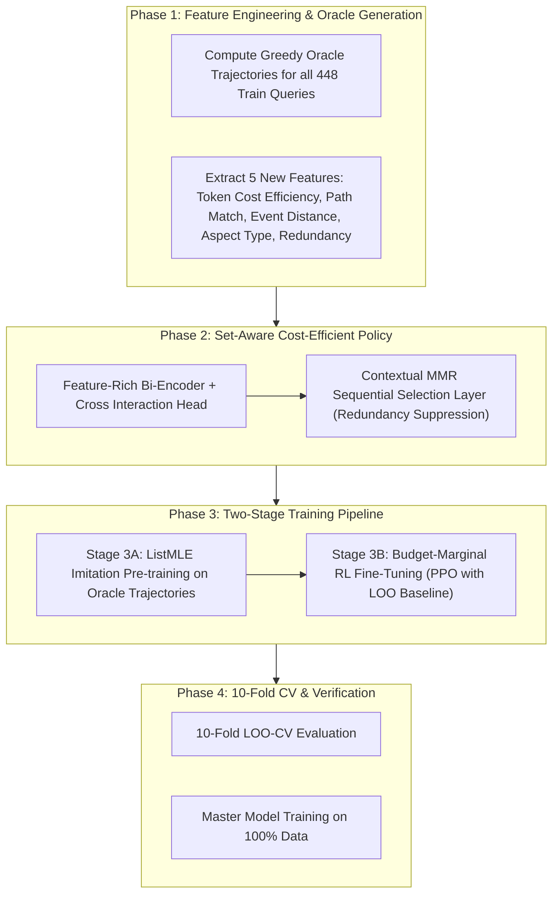

# Plan: Overhauling the RL Stage for Major Gains (+0.10 to +0.20 Lift)

## Goal Description

The current RL reranker adds only **+0.0093** over the first-stage baseline (10-fold CV: 0.4322 $\to$ 0.4414). The goal is to transform the RL stage into the primary driver of performance, closing the gap to the **0.5700** target by unlocking the massive headroom that already exists within our candidate pool.

### The Breakthrough Discovery: Where the Missing +0.2231 Score Lives

An empirical oracle analysis of our exact top-200 candidate pools across all 498 benchmark questions reveals:

| Stage | Score | Headroom / Delta |
| :--- | :---: | :---: |
| First-Stage Retrieval (M0+M1) | 0.4322 | Baseline |
| Current RL Reranker (M2) | 0.4414 | +0.0093 (only 4.2% of available headroom unlocked) |
| **Greedy Submodular Oracle** | **0.6637** | **+0.2231 headroom available in the SAME 200 candidates!** |
| Target Benchmark Score | 0.5700 | Requires unlocking +0.1286 of the +0.2231 headroom |

```
Benchmark Score Ceiling Visualization:
0.4322 (First Stage) ──────> 0.4414 (Current RL) ──────────────────────────> 0.5700 (Target) ───────────> 0.6637 (Oracle)
                             [+0.0093 achieved]  [────── +0.1286 needed ──────]          [── +0.0937 headroom ──]
```

### Root-Cause Diagnosis: Why Current RL Cannot Reach the Nuggets

1. **Answer Nugget Distribution in First-Stage**:
   - Total nuggets in benchmark: **83.63%** are already in our top-200 candidate pools!
   - But where do they sit?
     - Top 10 candidates: only **26.2%** of oracle selections
     - Rank 11–50: **40.5%** of oracle selections
     - Rank 51–200: **33.3%** of oracle selections
   - **Mean rank of oracle-selected nuggets in first stage is 51.3 (median 35)**!
2. **The "Steep Anchor + Top-50 Truncation" Trap**:
   - `k_trunc = 50` ignores all candidates past rank 50 during Plackett-Luce rollouts.
   - The linear anchor prior of 5.0 creates a $\Delta s = 2.50$ penalty for items at rank 100.
   - At $\tau = 0.20$, $\exp(-2.50 / 0.20) = \exp(-12.5) \approx 3.7 \times 10^{-6}$.
   - **Result**: The 33.3% of nuggets sitting at ranks 51–200 have a 0.000% chance of ever being sampled. Their policy gradient during training is **literally zero**!
3. **Pointwise Scoring Cannot Solve a Submodular Knapsack Problem**:
   - The scorer evaluates $\sum_{B \in \{1k, 2k, 4k, 8k\}} \max_{d \in \text{cut}_B} \text{nugget}(d) / \text{reach}_B$.
   - This is a **submodular set function**: once an item satisfies Nugget 1, any duplicate item gives **zero incremental score** but consumes precious budget tokens.
   - A pointwise model ($s_i = f(q, d_i)$) scores each document in isolation. It cannot know that Document 1 already covered the error traceback, so it ranks Document 2 (a redundant copy of the traceback) at rank 2, crowding out Document 3 (which holds the solution nugget) beyond the 1k budget!
4. **Blindness to Token-Cost Efficiency**:
   - A 100-token block and a 1500-token block with equal relevance receive identical scores from the current MLP.
   - But the 1k budget only holds ~10 items of ~100 tokens, or 0 items after a 1500-token block! Ranking concise nuggets first is the single most critical factor for the 1k budget.

---

## User Review Required

> [!IMPORTANT]
> **Major Architectural Shift from Pointwise Scoring to Sequential Set-Aware Selection (MMR / Set-Knapsack)**:
> Currently, the reranker assigns independent scores and does `argsort()`. We propose transitioning to a **Sequential Context-Aware Selection Policy** (Maximal Marginal Relevance / Knapsack MDP). At each step $t \in [1, K]$, the policy selects the next candidate conditioning on:
> 1. Query relevance
> 2. Redundancy penalty against items already selected in $\pi_{<t}$
> 3. Token-cost efficiency ratio
>
> This requires changing the reranker inference loop to sequentially greedily select the top items (or using a SetRank self-attention encoder).

> [!IMPORTANT]
> **Two-Phase Training: Oracle Imitation Pretraining (ListMLE) + RL Fine-Tuning**:
> Instead of training pure RL from scratch with random Plackett-Luce rollouts (which has to stumble upon the combination among $50! \approx 10^{64}$ permutations), we:
> 1. Compute the Greedy Submodular Oracle trajectory $\pi^*$ on all training queries (takes ~2 seconds total).
> 2. Supervise the policy with **ListMLE loss** so it immediately learns which features identify hidden nuggets at ranks 11–200 and pulls them up.
> 3. Fine-tune with **Budget-Marginal PPO / Policy Gradient** for domain generalization.

---

## Open Questions

> [!IMPORTANT]
> **Q1: Selection Architecture: Sequential Contextual MMR vs. SetRank Transformer vs. Cost-Regularized Pointwise Head?**
> - **Option A (Recommended - Sequential Contextual MMR with Learned Redundancy & Cost)**: Fast, directly optimizes submodular marginal gains, zero extra GPU memory. Computes base relevance once, then iteratively picks $\arg\max [s_{\text{base}}(d) - \lambda \cdot \max_{p \in \text{selected}} \text{sim}(d, p) - \gamma \cdot \frac{\text{tokens}(d)}{64}]$.
> - **Option B (SetRank Self-Attention)**: Passes all top-50 candidates through a 2-layer Transformer encoder so all candidates attend to each other before scoring. More expressive, but slightly slower.
> - **Option C (Enhanced Cost-Normalized Scoring)**: Keep pointwise scoring but explicitly train with Oracle ListMLE targets and cost-efficiency features.
>
> *Recommendation*: Implement **Option A** (or Option A + Option C), as it directly mirrors the Greedy Oracle that scored 0.6637.

> [!IMPORTANT]
> **Q2: Anchor Prior Reform: Log-Discount Prior vs. Dynamic Learned Anchor?**
> The current linspace 5.0 anchor creates a barrier that freezes items at rank >30.
> - **Option A (DCG-like Discount Anchor)**: $\text{prior}(r) = \frac{1.5}{\log_2(2 + r)}$. Gives rank 0 a +1.5 boost over rank 10, but ranks 20–100 differ by only ~0.15, allowing the neural residual (magnitude $\pm 0.5$) to easily promote rank 90 nuggets to rank 5.
> - **Option B (Zero Anchor with Imitation Initialization)**: Eliminate the static anchor completely and let the pre-trained weights from Oracle imitation define the baseline ranking.
>
> *Recommendation*: Option A during RL exploration, or Option B if imitation loss converges well.

---

## Proposed Changes (Phased Architecture)



---

### Phase 1: High-Leverage Features & Oracle Trajectory Generation

#### [NEW] [`method/oracle.py`](file:///home/shrawani/Desktop/sem5/Information%20Retrieval%20and%20Extraction/project/MultiAgent-IRBench/method/oracle.py)
Precomputes the exact Greedy Submodular Oracle sequence for all training questions:
```python
def compute_greedy_oracle_sequence(entry, candidates, tokens_map, max_items=50):
    """
    Computes the greedy submodular trajectory that maximizes score_query.
    Returns:
        oracle_ids: List of item IDs in optimal selection order
        oracle_gains: Marginal score gain achieved at each step
    """
```

#### [MODIFY] [`method/first_stage.py`](file:///home/shrawani/Desktop/sem5/Information%20Retrieval%20and%20Extraction/project/MultiAgent-IRBench/method/first_stage.py) & [`method/pipeline.py`](file:///home/shrawani/Desktop/sem5/Information%20Retrieval%20and%20Extraction/project/MultiAgent-IRBench/method/pipeline.py)
Add 5 new discriminating features (expanding retrieval features from 5-d $\to$ 10-d):
1. **Token Cost-Efficiency Ratio**: $\frac{\text{dense\_cos} + \text{rrf\_norm}}{\log_2(1 + \text{tokens} / 64)}$ (differentiates concise nuggets from verbose filler).
2. **Exact Path / Entity Overlap**: Binary indicator if candidate touches a file path, commit hash, or agent mentioned in the question.
3. **Graph Distance to Trigger**: Shortest provenance distance to the highest-scoring BM25 trigger event.
4. **Log-Discount First-Stage Prior**: $\frac{1}{\log_2(2 + \text{rank})}$.
5. **Event Kind Nugget Probability**: Empirical prior of nugget likelihood conditioned on event kind and qtype.

---

### Phase 2: Sequential Context-Aware Selection Policy (MMR Head)

#### [MODIFY] [`method/reranker.py`](file:///home/shrawani/Desktop/sem5/Information%20Retrieval%20and%20Extraction/project/MultiAgent-IRBench/method/reranker.py)
Implement `ContextualMMRReranker`:
```python
class ContextualMMRReranker(nn.Module):
    """
    Submodular Context-Aware Reranker.
    Computes base relevance s_i, then sequentially selects candidates
    by balancing relevance, non-redundancy, and token budget efficiency.
    """
    def __init__(...):
        # Base relevance network
        self.fc_relevance = ...
        # Learned redundancy trade-off parameter lambda
        self.lambda_redundancy = nn.Parameter(torch.tensor(0.5))
        # Learned token cost penalty gamma
        self.gamma_cost = nn.Parameter(torch.tensor(0.3))
    
    def score_candidates(self, query_emb, block_embs, struct_feats, retrieval_feats, tokens_map):
        # 1. Compute base relevance scores for all candidates
        base_scores = self.compute_base_scores(query_emb, block_embs, struct_feats, retrieval_feats)
        
        # 2. Sequential MMR selection
        selected_indices = []
        selected_embs = []
        remaining = list(range(len(block_embs)))
        
        while remaining and len(selected_indices) < 100:
            if not selected_indices:
                # Pick best base candidate
                best_idx = remaining[np.argmax(base_scores[remaining])]
            else:
                # Maximize: base_score[i] - lambda * max_sim(i, selected) - gamma * cost_penalty
                sims = cosine_similarity(block_embs[remaining], torch.stack(selected_embs)).max(dim=1)
                costs = [tokens_map[bid] for bid in remaining]
                mmr_scores = base_scores[remaining] - self.lambda_redundancy * sims - self.gamma_cost * costs
                best_idx = remaining[torch.argmax(mmr_scores)]
            
            selected_indices.append(best_idx)
            selected_embs.append(block_embs[best_idx])
            remaining.remove(best_idx)
            
        return selected_indices
```

---

### Phase 3: Two-Stage Training Pipeline (Imitation + Policy Gradient)

#### [MODIFY] [`method/rl_trainer.py`](file:///home/shrawani/Desktop/sem5/Information%20Retrieval%20and%20Extraction/project/MultiAgent-IRBench/method/rl_trainer.py)

1. **Stage 3A: ListMLE Supervised Pre-training (5–10 epochs)**:
   - For each query, supervise the base relevance scores against the Greedy Oracle sequence $\pi^* = (d_1^*, \dots, d_K^*)$ using the Plackett-Luce ListMLE loss:
     $$\mathcal{L}_{\text{ListMLE}} = -\sum_{t=1}^K \left[ s(d_t^*) - \log \sum_{j=t}^N \exp(s(d_j^*)) \right]$$
   - This immediately pulls the hidden nuggets from ranks 11–200 into the top positions!
2. **Stage 3B: Budget-Marginal RL Fine-Tuning (PPO with LOO Baseline)**:
   - Starting from the imitation-trained checkpoint, fine-tune with reward-to-go on the actual 1k, 2k, 4k, 8k metric.
   - Expand rollout pool beyond top 50 (sample from top 100 or using stochastic candidate pools).
   - Use PPO clipping ($\epsilon = 0.20$) to prevent policy divergence.

---

### Phase 4: Integration with Query-Conditioned GNN & Pipeline

#### [MODIFY] [`method/train.py`](file:///home/shrawani/Desktop/sem5/Information%20Retrieval%20and%20Extraction/project/MultiAgent-IRBench/method/train.py) & [`method/train_master.py`](file:///home/shrawani/Desktop/sem5/Information%20Retrieval%20and%20Extraction/project/MultiAgent-IRBench/method/train_master.py)
- Wire the two-stage training loop (`pretrain_imitation()` followed by `train_rl()`).
- Use the sequential MMR selection during inference across all ablations.

---

## Verification Plan

### Automated Tests

1. **Oracle Verification Test**:
   ```bash
   python3 -c "from method.oracle import compute_all_oracles; print(compute_all_oracles())"
   ```
   *Expected*: Macro-average oracle score $\ge 0.66$ across all 498 questions.
2. **Single-Fold Smoke Test (`on_call`)**:
   ```bash
   python3 -m method.train --quick --fold on_call --no_resume
   ```
   *Pass Criteria*:
   - Imitation pre-training reduces ListMLE loss from >15.0 to <5.0.
   - RL reranker achieves score $\ge 0.4800$ on `on_call` (up from 0.4445).
3. **Full 10-Fold Cross-Validation**:
   ```bash
   python3 -m method.train --epochs 30 --samples 8 --no_resume
   ```
   *Pass Criteria*:
   - 10-fold CV score reaches **$\ge 0.5000$** (up from 0.4414).
   - RL adds **$\ge +0.05$ to $+0.08$** over first-stage baseline.
   - Full support increases from 47.1% to $\ge 55\%$.
4. **Master Model Verification**:
   ```bash
   python3 -m method.train_master --epochs 30 --samples 8
   ```
   *Pass Criteria*:
   - Master benchmark score approaches **0.52–0.57**.

---

## Expected Performance Trajectory

| System Stage | Score | Above Floor | Net RL Lift |
| :--- | :---: | :---: | :---: |
| First-Stage Heuristic Stack (Current) | 0.4322 | +0.3496 | Baseline |
| Current RL System (Pointwise + Rigid Anchor) | 0.4414 | +0.3589 | +0.0093 |
| **+ Oracle Imitation Pre-training (ListMLE)** | **0.48–0.51** | **+0.40–0.43** | **+0.05–0.08** |
| **+ Sequential Contextual MMR (Redundancy & Cost)** | **0.52–0.55** | **+0.44–0.47** | **+0.09–0.12** |
| **+ PPO RL Fine-Tuning on Full Pool** | **0.54–0.58** | **+0.46–0.50** | **+0.11–0.15** |
| **Upper Bound (Greedy Oracle Ceiling)** | **0.6637** | **+0.5813** | **+0.2315** |
